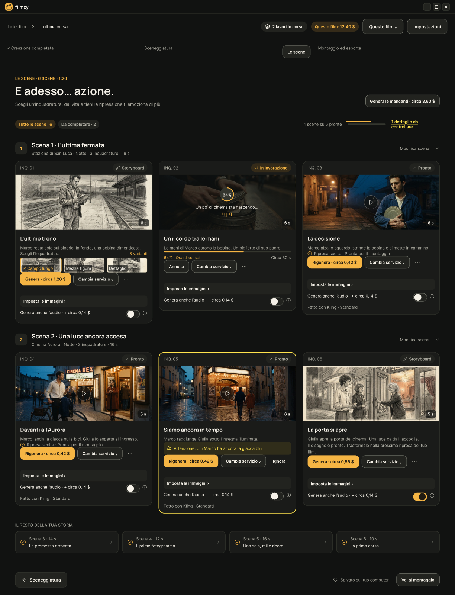
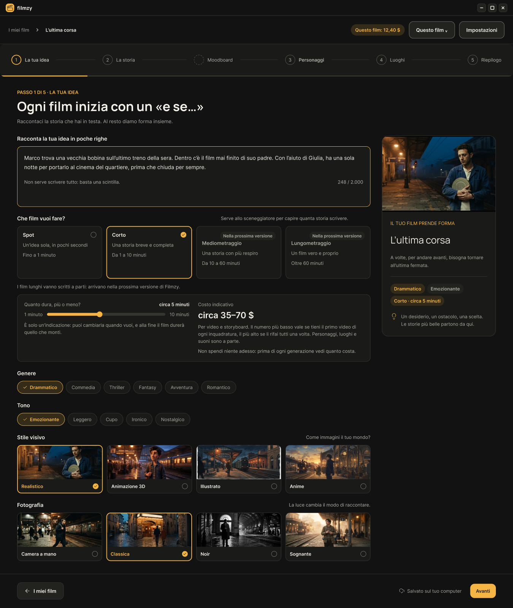
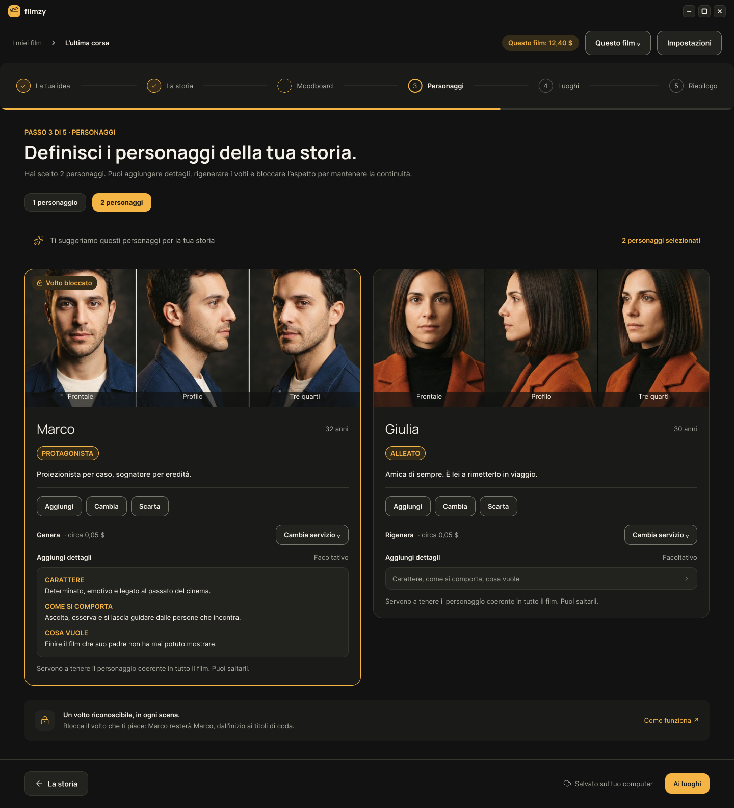
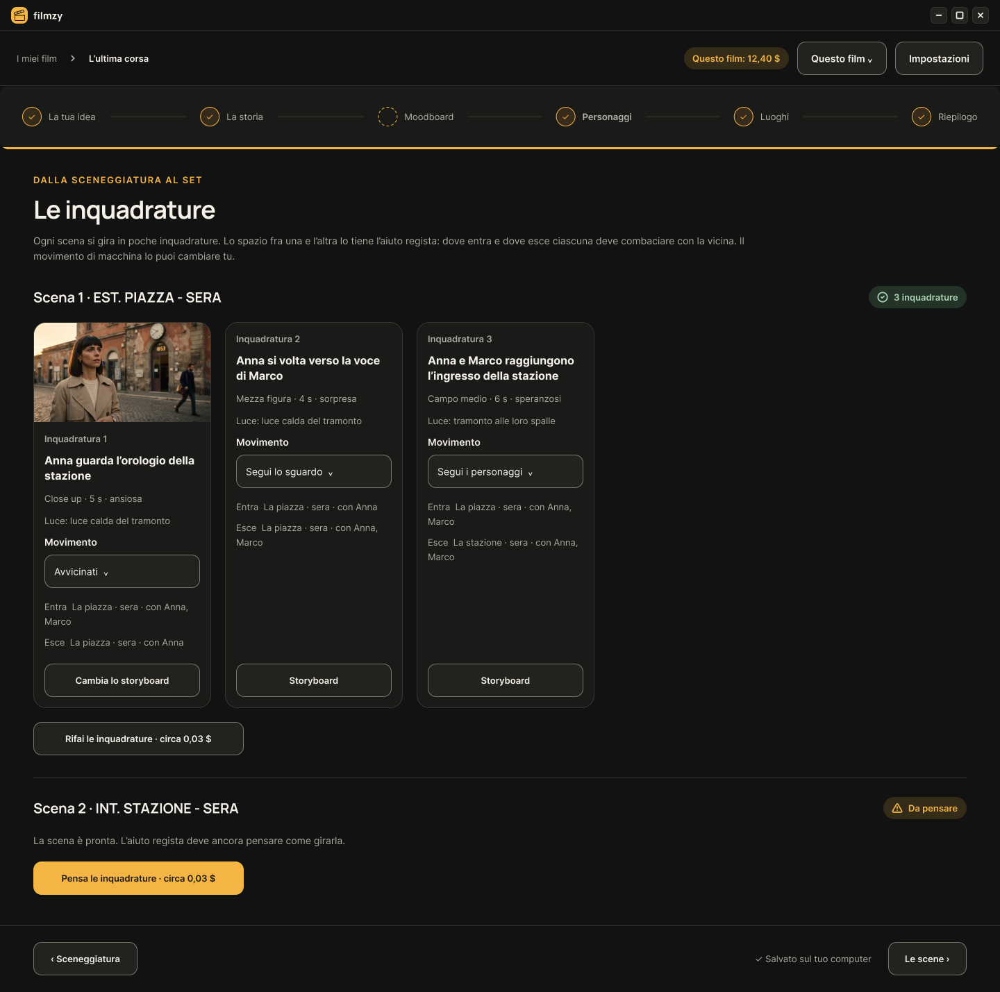
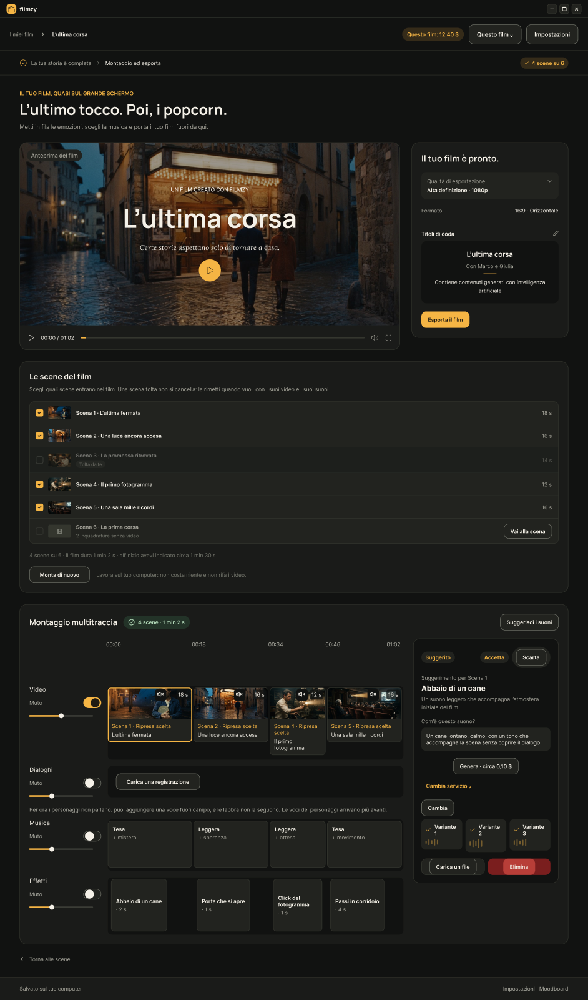
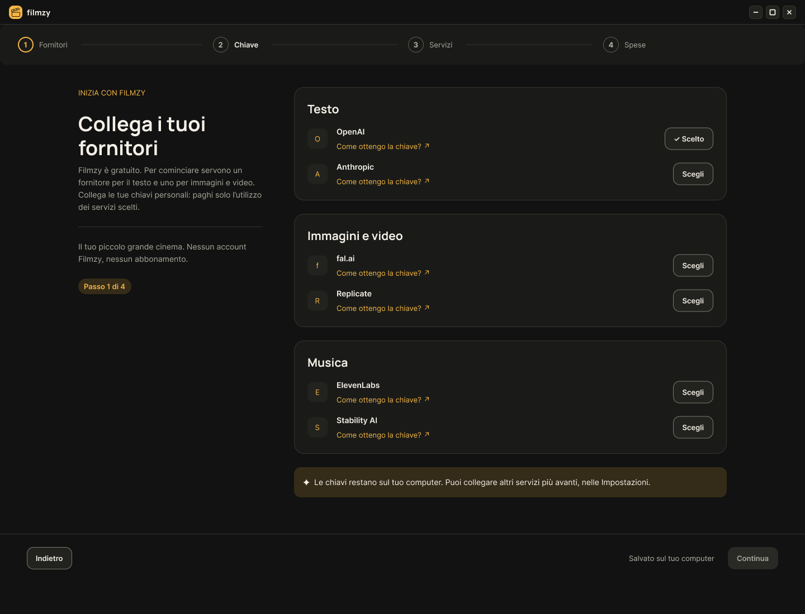

<p align="center">
  
</p>

<h1 align="center">Filmzy</h1>

<p align="center"><strong>Il tuo piccolo grande cinema.</strong><br />
Cortometraggi con la gen AI, sul tuo computer, anche se non sai programmare.</p>

<p align="center">
  
</p>

Filmzy è un programma libero (AGPL-3.0) che ti accompagna dall'idea al film finito: la storia, i personaggi, i luoghi, la sceneggiatura, le scene girate una alla volta, la musica, gli effetti e il montaggio coi titoli. Gira **sul tuo computer**, con **le tue chiavi** dei servizi AI: nessun server, nessun account, nessun abbonamento, nessun pagamento a noi.

Filmzy fa il direttore di produzione: i servizi AI generano, Filmzy ricorda. Tiene i personaggi uguali da una scena all'altra, ti avvisa quando qualcosa non torna e ti dice quanto costa ogni passo **prima** di farlo.

> **A che punto è:** in sviluppo. La prima versione non è ancora uscita; l'installatore per Windows si può già costruire dal codice (vedi [Provare Filmzy](#provare-filmzy)). Le immagini qui sotto vengono dal progetto grafico: il programma può differire in qualche dettaglio.

## Come funziona

<table>
  <tr>
    <td width="50%"></td>
    <td width="50%"></td>
  </tr>
  <tr>
    <td><strong>1 · La tua idea.</strong> Scrivi l'idea, scegli genere, tono, stile e quanto deve durare: vedi subito un costo indicativo.</td>
    <td><strong>2 · Storia, personaggi e luoghi.</strong> Filmzy scrive la bozza e propone il cast. Blocchi il volto che ti piace, e il personaggio resta lui fino ai titoli di coda.</td>
  </tr>
  <tr>
    <td></td>
    <td></td>
  </tr>
  <tr>
    <td><strong>3 · Le inquadrature.</strong> Ogni scena si divide in poche inquadrature, con storyboard, primo e ultimo fotogramma; poi si gira il video, scegliendo il servizio e vedendo il costo.</td>
    <td><strong>4 · Montaggio ed esporta.</strong> Musica, effetti e titoli; scegli le scene che entrano nel film ed esporti il file, nella qualità e nel formato che vuoi.</td>
  </tr>
</table>

Il primo avvio ti guida: colleghi i fornitori, inserisci le chiavi e scegli quanto vuoi spendere al massimo.

<p align="center">
  
</p>

## Cosa ti serve

- Un computer con Windows (macOS e Linux arrivano con le prossime versioni).
- Le chiavi dei servizi AI che vuoi usare. Per cominciare servono **Anthropic** (per il testo) e **fal.ai** (per immagini, video, musica ed effetti). Al primo avvio Filmzy ti dice dove prenderle.
- Un credito presso quei servizi: le generazioni le paghi a loro, non a Filmzy. Prima di ogni generazione vedi quanto costa, e puoi impostare dei limiti di spesa.

## Provare Filmzy

Quando uscirà la prima versione, l'installatore si scaricherà dalle **Release** di questa pagina: si scarica solo il programma, non il codice. Fino ad allora ci sono tre modi, tutti dal codice (servono [Node 24](https://nodejs.org) e [pnpm](https://pnpm.io)):

```bash
pnpm install
```

| Per… | Comando | Cosa succede |
|---|---|---|
| **installarlo su Windows** | `pnpm pacchetto` | crea `apps/desktop/release/Filmzy-0.1.0-installa.exe`: aprilo e segui l'installazione |
| **provarlo senza spendere** | `TROUPE_ENV=offline FILMZY_DATA_DIR=./dati-di-prova pnpm dev` | si apre nel browser su <http://localhost:5173> con un fornitore finto: niente chiavi, niente costi, risultati di prova, dati in una cartella a parte |
| **provarlo coi servizi veri** | `pnpm dev` | come sopra, ma con le tue chiavi nel file `.env` (nel browser il portachiavi non c'è: le chiavi si salvano solo dal programma installato) |

Su Windows, nel terminale PowerShell, le variabili si scrivono così: `$env:TROUPE_ENV="offline"; $env:FILMZY_DATA_DIR="./dati-di-prova"; pnpm dev`.

Il programma non è ancora firmato: Windows può mostrare l'avviso «Windows ha protetto il PC». Si va avanti con «Ulteriori informazioni» › «Esegui comunque». Disinstallando, i film restano dove sono.

Se qualcosa si rompe, Filmzy lo scrive nel **registro**: un file al giorno nella cartella `log` dentro la cartella dei tuoi dati. Il registro non contiene le chiavi, e la tua cartella personale ci compare come `~`. Se chiedi aiuto, allega il file del giorno in cui è successo.

## I tuoi dati

- I film, le immagini e i video stanno solo sul tuo computer: su Windows in `%APPDATA%\Filmzy`, su macOS in `~/Library/Application Support/Filmzy`, su Linux in `~/.local/share/filmzy`. Li trovi anche in Impostazioni › I tuoi dati.
- Un film si salva in un file `.filmzy`, da riaprire anche su un altro computer. Una versione nuova di Filmzy apre i film delle versioni vecchie.
- Le chiavi stanno nel portachiavi del sistema e non finiscono mai nella copia di un film.
- **Nessuna telemetria:** Filmzy non manda niente a chi l'ha fatto. Contatta solo i servizi che colleghi tu e, se lo lasci acceso, GitHub per sapere se c'è una versione nuova.

## Per chi sviluppa

| Documento | Contenuto |
|---|---|
| `CLAUDE.md` | regole per Claude Code |
| `docs/contesto-progetto.md` | cosa fa il prodotto e perché (copia dal progetto Claude) |
| `docs/architettura.md` | com'è fatto il sistema |
| `docs/piano-di-lavoro.md` | cosa fare, in ordine |
| `docs/decisioni.md` | perché è fatto così |
| `docs/ricerca-ottobre-2026.md` | ricerca su modelli, prezzi e aspetti legali (13/10/2026) |
| `config/` | seme della configurazione: troupe, preset, funzioni, prove sui modelli |
| `design/` | il prossimo prompt per Figma, lo storico di quelli lanciati e i riferimenti grafici esportati |

Monorepo pnpm con TypeScript: server locale NestJS (`apps/api`), interfaccia React (`apps/web`), programma per computer Electron (`apps/desktop`), SQLite e ffmpeg. Docker non serve.

```bash
pnpm dev     # server locale su http://127.0.0.1:3001 e interfaccia su http://localhost:5173
pnpm test    # col fornitore finto: zero costi
pnpm check   # lint, tipi, test, build, stile e confini del codice: da far passare prima di una pull request
pnpm --filter @filmzy/desktop build && pnpm --filter @filmzy/desktop start   # il programma per computer senza installarlo
```

Il file `.env` è facoltativo: copia `.env.example` in `.env` solo per cambiare le impostazioni (per esempio la porta); `pnpm dev` lo legge. Una variabile già impostata nel terminale ha la precedenza sul file.

## Licenza

Filmzy è software libero con licenza **AGPL-3.0** (vedi `LICENSE`). Chi pubblica una copia modificata, anche solo come servizio online, deve rendere disponibile il codice.

## Uso responsabile

Filmzy è fornito «così com'è», senza garanzie. Sei tu a rispondere dei file che carichi, dei contenuti che crei e di come li pubblichi.

- Usa solo musica, immagini e voci di cui hai i diritti.
- Non creare contenuti che imitano persone reali o che ingannano chi guarda, e dichiara quando un video è generato con intelligenza artificiale. Per impostazione predefinita Filmzy aggiunge una dicitura nei titoli.
- Rispetta le condizioni dei servizi che colleghi con le tue chiavi: violarle può far bloccare il tuo account presso il fornitore.
- I costi dei servizi AI sono a tuo carico. Filmzy ti mostra una stima prima di ogni generazione e ti lascia impostare dei tetti di spesa, ma imposta un limite anche nel pannello di ogni fornitore.
