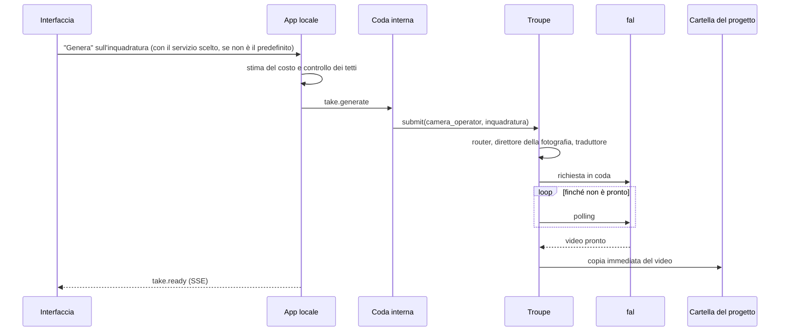

# Filmzy — Architettura

_Versione 2 · 20 ottobre 2026 (la versione 1 è del 19 ottobre) · Filmzy è software libero (AGPL-3.0) e gira in locale: decisioni D28–D32; scelta del servizio per generazione: D36_

Questo documento descrive **com'è fatto** il sistema. Cosa fa il prodotto e perché sta in `contesto-progetto.md` (l'originale nel progetto Claude, una copia in `docs/`); le scelte e le alternative scartate in `decisioni.md`; l'ordine dei lavori in `piano-di-lavoro.md`.

## 1. Principi tecnici

1. **Il codice chiama ruoli, mai modelli.** Ogni lavoro AI è un ruolo della troupe. Quale modello lo svolge, con quali parametri e con quali istruzioni, è configurazione.
2. **La configurazione ha le stesse garanzie del codice:** validata, versionata, provata prima della pubblicazione, reversibile.
3. **Contratti prima.** Ogni dato che attraversa un confine ha uno schema Zod in `packages/contracts`.
4. **Ogni chiamata a un fornitore lascia uno scontrino**, anche se fallisce.
5. **I test non spendono:** nei test risponde il fornitore finto.
6. **I fornitori sono inaffidabili per definizione:** code, nuovi tentativi, idempotenza, copia immediata dei file.
7. **Le regole dei fornitori si rispettano:** un rifiuto per contenuto non si aggira provando un altro modello.
8. **Tutto in locale (D29).** Nessun server dell'autore: dati, file e chiavi restano sul computer dell'utente, e l'unico traffico in uscita va ai fornitori che l'utente ha scelto.
9. **I costi sono dell'utente e sempre visibili (D30):** stima prima di ogni generazione e tetti di spesa che l'utente regola.

## 2. Stack e repository

| Area | Scelta | Perché |
|---|---|---|
| Linguaggio | TypeScript strict, ovunque | un solo linguaggio; contratti condivisi tra interfaccia e backend |
| Monorepo | pnpm workspaces + Turborepo | build e test incrementali |
| API | NestJS 12 (moduli ES), come server locale | moduli e dependency injection: la struttura è guidata dal framework; gira sul computer dell'utente, in un solo processo, solo su `127.0.0.1` |
| Lavori lunghi | coda interna al processo, salvata in SQLite | nuovi tentativi, limiti di concorrenza, ripresa dopo la chiusura del programma; nessun Redis |
| Interfaccia | React + Vite (SPA) | la logica sta nel backend; l'interfaccia mostra e invia |
| Database | SQLite + Drizzle ORM, driver `better-sqlite3` (D45) | un file nella cartella dati dell'utente, fuori da quella del programma (§6.1), nessun servizio da installare; JSON tipizzato con Zod |
| File | cartella locale (`AssetStore`) | un film è una cartella, facile da copiare come backup |
| Segreti | portachiavi del sistema operativo (Electron `safeStorage`, D45) | le chiavi non stanno in chiaro su disco, e il blob cifrato sta in un file della cartella dati, non nel database: le copie del database non possono portarle via |
| Trasporto LLM | AI SDK (Vercel), solo dentro gli adapter | molti fornitori, output strutturati con Zod, `baseURL`, `headers` e `fetch` personalizzabili per gateway e proxy |
| Immagini e video | client ufficiale di fal, solo dentro l'adapter | un'API per molti modelli; in locale si usa sempre il polling |
| Istruzioni | template LiquidJS | sintassi semplice e sicura anche quando le istruzioni si modificano dalle impostazioni |
| Montaggio | ffmpeg | standard |
| Aggiornamenti live | Server-Sent Events | restano comodi tra il server locale e l'interfaccia |
| Programma | Electron: installatori per Windows, macOS e Linux, aggiornamenti da GitHub Releases con l'ok dell'utente (§6.2, D44) | chi non programma non installa Node: si installa con un doppio clic |
| Licenza | AGPL-3.0 | software libero; chi pubblica una copia modificata deve tenerla aperta |
| Python | più avanti, come servizio separato | controllo dei volti, modelli locali: la troupe lo vede come una connessione in più |

```
filmzy/
├─ LICENSE                  AGPL-3.0
├─ CLAUDE.md                regole per Claude Code
├─ docs/                    architettura, piano di lavoro, decisioni
├─ design/                  prossimo prompt per Figma, storico dei prompt lanciati, riferimenti grafici
├─ config/
│  ├─ ai/                   seme della troupe: connessioni, modelli, ruoli, istruzioni
│  │  └─ environments/      adattamenti per development, offline e test
│  ├─ presets/              stili, generi, toni, fotografia, tag dei personaggi, movimenti di macchina
│  ├─ features.yaml         funzioni attive e limiti
│  └─ bench/                piani delle prove sui modelli
├─ apps/
│  ├─ api/                  NestJS: server locale (HTTP, dominio, lavori in coda, eventi)
│  ├─ web/                  React: l'app, con le Impostazioni (connessioni, troupe avanzata, costi)
│  ├─ desktop/              Electron: finestra, portachiavi, installatori, aggiornamenti
│  └─ bench/                riga di comando: valutazioni e prove dei modelli
└─ packages/
   ├─ contracts/            schemi Zod: dominio, ruoli, configurazione, eventi
   ├─ troupe/               livello AI: configurazione, router, adapter, traduttori, scontrini
   ├─ db/                   schema Drizzle (SQLite), migrazioni
   └─ media/                ffmpeg, esportazione, etichetta AI
```

## 3. Moduli e confini

| Modulo | Dove | Responsabilità |
|---|---|---|
| `spend` | api | stime, tetti di spesa e spesa fatta, calcolati dagli scontrini (D30) |
| `projects` | api | il film: idea, genere, tono, stile, fotografia, lingua, durata, fase (§3.1) |
| `bible` | api | personaggi (con tag e dettagli), luoghi (con immagini), schede; assembla la Bibbia per i ruoli |
| `screenplay` | api, worker | sceneggiatura con versioni e fase (bozza o finale), richieste di modifica, riepilogo con le scelte |
| `moodboard` | api, worker | moodboard del film e delle scene: palette, consigli, immagini di riferimento generate o caricate e analizzate (D37) |
| `scenes` | api | scene, inquadrature (ShotSpec), take |
| `generations` | worker | esegue i ruoli tramite la troupe, controlla i lavori con il polling, scrive gli scontrini |
| `assets` | api, worker | file: caricamento con controllo delle immagini, ritocchi, copia dai fornitori nella cartella del progetto |
| `audio` | api, worker | tracce e clip audio (musica, effetti, dialoghi), varianti, volumi (§5.5) |
| `continuity` | api, worker | stati di entrata e uscita, regole, segnalazioni gialle |
| `export` | worker | montaggio, mix delle tracce audio, titoli, etichetta AI (marcatura C2PA come opzione) |
| `consents` | api | persone reali e consensi: tabelle presenti, funzione spenta nell'MVP |
| `settings` | api, web | Impostazioni: connessioni e chiavi, troupe avanzata (bozza, prova, pubblicazione, storico), preset, funzioni, costi (§4.5); le scelte di ogni giorno dell'utente (servizi attivati, predefiniti, tetti), che non richiedono una pubblicazione (D36) |

In locale `api` e `worker` girano nello stesso processo (D29): «worker» indica solo i lavori in coda.

**Confini controllati dalla CI**, non affidati alla buona volontà:

- `apps/web` importa solo `packages/contracts`.
- Solo `packages/troupe/src/adapters/**` importa le librerie dei fornitori (`ai`, `@ai-sdk/*`, `@fal-ai/client`, …).
- `packages/troupe` non importa `packages/db`. Riceve la configurazione da una `ConfigSource` e scrive gli scontrini su un `ReceiptSink`: l'app li implementa con il database, il bench e i test con file o memoria. Così la troupe gira identica ovunque.
- Nel codice di `apps/` e `packages/` (test esclusi) non compaiono identificativi di modelli né URL di fornitori. Il controllo usa il catalogo stesso come elenco dei termini vietati.
- Ogni pacchetto **dichiara** i pacchetti del monorepo che importa, test compresi. Senza, l'import funziona comunque (pnpm lo trova passando dalla radice) ma Turbo non sa che deve costruirlo prima, e la CI fallisce quando capita: è successo in T2.2.

### 3.1 Le fasi di un progetto

Il progetto avanza per fasi (D18). Si può sempre tornare a una fase precedente: le scelte successive restano e le differenze si ricalcolano al riepilogo.

| Fase | Cosa succede | Ruoli |
|---|---|---|
| `idea` | genere, tono, stile, fotografia, durata; il moderatore controlla il testo | `moderator` |
| `draft` | bozza breve della sceneggiatura; richieste di modifica a turno singolo («Parla con lo sceneggiatore»), moderate, che creano una nuova versione | `screenwriter` (`draft`, `revise`), `moderator` |
| `moodboard` | facoltativo ma consigliato (D37): palette, consigli e immagini di riferimento per il film e per singole scene, generati dall'app o caricati dall'utente | `moodboard_designer`, `moodboard_artist`, `image_analyst` |
| `cast` | numero di personaggi (non oltre `limits.max_characters`), proposte dalla bozza con tag e dettagli facoltativi, schede a 3 angolazioni, volto bloccato | `casting`, `character_designer` |
| `locations` | 3–4 immagini del set per luogo, scelta e, se `retouch` è attiva, ritocco | `set_designer`, `retoucher` |
| `review` | il codice confronta la bozza con le scelte: una differenza è un personaggio o un luogo che la bozza cita e la Bibbia non ha, o viceversa (li collega il `proposalId`). Per ognuna: «Adatta la storia», «Cambia la mia scelta» o «Va bene così» (l'elemento resta come comparsa o luogo generico). Senza differenze il passo si salta | nessuno: la scelta pesa sulla stesura |
| `final` | stesura ufficiale, che usa solo cast e luoghi scelti più gli elementi accettati; poi modificabile come testo, con versioni | `screenwriter` (`final`) |
| `shots` | inquadrature, storyboard, immagini dell'inquadratura, take | `shot_planner`, `cinematographer`, `storyboard_artist`, `camera_operator`, `script_supervisor` |
| `sound` | tracce audio: musica per scena, effetti per inquadratura, suggerimenti dal copione («Suggerisci i suoni»), file audio propri; l'audio originale dei take è spento | `sound_planner`, `composer`, `sfx_artist` |
| `export` | montaggio, mix delle tracce ed esportazione | |

«Bozza» ha due significati: la bozza della sceneggiatura e la bozza della troupe (`TroupeDraft`, nelle impostazioni avanzate).

## 4. La troupe

### 4.1 L'idea

Su un set i ruoli sono fissi, e chi li ricopre si decide sul foglio di produzione. Qui il codice è il set e la configurazione è il foglio di produzione: il codice chiede a un ruolo e non sa quale modello risponderà, con quale temperatura o con quali istruzioni.

L'interfaccia pubblica di `packages/troupe`:

```ts
troupe.run(role, input, ctx)      // ruoli LLM: risposta tipizzata e scontrino
troupe.submit(role, input, ctx)   // ruoli immagine e video: lavoro lungo, restituisce l'id presso il fornitore
troupe.collect(receiptId, event)  // completa il lavoro quando il polling lo trova finito
troupe.estimate(role, input, ctx) // costo previsto e servizio che lavorerà, per la stima e i tetti di spesa
troupe.options(role, request)     // i servizi tra cui l'utente può scegliere per questa richiesta, ognuno con nome, costo stimato e voto (D36)
```

`ctx` dice chi chiede e perché (progetto, inquadratura, scopo) e, per le generazioni di immagini, video, musica ed effetti, può portare un `modelId`: il servizio che l'utente ha scelto per questa singola generazione. Sta nel `ctx` e non nell'input del ruolo, quindi non entra negli schemi di §5.3; fa però parte della chiave di idempotenza e dell'hash della richiesta, così rigirare la stessa inquadratura con un altro servizio non è un doppione. Per il router è un requisito, non un suggerimento (§4.8). Il codice non scrive mai un `modelId` di suo: lo riceve dall'utente, da una voce del catalogo.

`estimate` restituisce anche il servizio **fissato**, cioè quello scelto o, senza scelta, il predefinito: il lavoro in coda usa quello, anche se nel frattempo le impostazioni cambiano. I ruoli LLM (`run`) lavorano sempre con il loro predefinito: la scelta per generazione non li riguarda.

### 4.2 I ruoli

| Id | Nome | Tipo | Riceve → restituisce | Quando |
|---|---|---|---|---|
| `moderator` | Moderatore | LLM | testo dell'utente → verdetto | MVP |
| `casting` | Direttore del casting | LLM | idea, bozza e cast attuale → proposte di personaggi, con tag e dettagli facoltativi | MVP |
| `screenwriter` | Sceneggiatore | LLM | tre modi: idea → bozza breve con personaggi e luoghi proposti; bozza + richiesta → bozza nuova; bozza + Bibbia → stesura ufficiale | MVP |
| `shot_planner` | Aiuto regista | LLM | scena e Bibbia → inquadrature (ShotSpec) | MVP |
| `cinematographer` | Direttore della fotografia | LLM | inquadratura + famiglia del modello → prompt visivo | MVP |
| `character_designer` | Character designer | immagine | personaggio e stile → scheda a 3 angolazioni | MVP |
| `set_designer` | Scenografo | immagine | luogo e stile → 3–4 immagini del set, senza persone | MVP |
| `moodboard_designer` | Moodboard | LLM | idea, stile, sceneggiatura e, per una scena, la scena → palette, consigli e prompt per le immagini di riferimento | opzione dell'MVP (`moodboard`) |
| `moodboard_artist` | Immagini del moodboard | immagine | prompt di riferimento e stile → immagini | opzione dell'MVP (`moodboard`) |
| `image_analyst` | Analista di immagini | LLM con visione | immagine caricata → descrizione, atmosfera, luce, composizione e controllo di persone e marchi | opzione dell'MVP (`moodboard`) |
| `retoucher` | Ritocco | immagine | immagine + maschera + operazione → immagine ritoccata | opzione dell'MVP (`retouch`) |
| `storyboard_artist` | Storyboard | immagine | modo `storyboard`: prompt visivo + riferimenti → 2–3 varianti; modo `end_frame`: primo fotogramma + movimento → ultimo fotogramma | MVP |
| `camera_operator` | Operatore di ripresa | video | prompt visivo + riferimenti → take | MVP |
| `script_supervisor` | Segretaria di edizione | LLM | scene e inquadrature → incoerenze con motivo | MVP |
| `composer` | Compositore | musica | atmosfera e durata di una scena → musica | MVP, spento finché non si sceglie il fornitore (T5.4) |
| `sfx_artist` | Rumorista | effetti sonori | descrizione e durata → 2–3 varianti | MVP, spento finché non si sceglie il fornitore (T5.4) |
| `sound_planner` | Sound designer | LLM | copione, scene e inquadrature → proposte di musica ed effetti | MVP |
| `voice_actor` | Doppiatore | voce | battuta + voce del personaggio → audio | Fase 2 |
| `lip_sync` | Sincronizzatore | video | take + audio → take sincronizzato | Fase 2 |
| `dialogue_adapter` | Adattatore dialoghista | LLM | dialoghi + durate → dialoghi tradotti | Fase 3 |

Il montaggio non è un ruolo: è deterministico (ffmpeg) e vive in `packages/media`.

**Cosa sta nel codice e cosa nella configurazione.** Nel codice ci sono l'elenco dei ruoli e i loro schemi di input e output (`packages/contracts/src/roles.ts`), perché è il codice a usare le risposte. Tutto il resto è configurazione.

**Lingue.** Interfaccia, istruzioni e testi per l'utente sono in italiano. I prompt per i modelli di immagini e video sono in inglese, perché di solito i modelli li seguono meglio: per le inquadrature li scrive il direttore della fotografia, per le schede personaggio il casting (campo `appearance.prompt`).

### 4.3 Tre livelli di configurazione

| Livello | Domanda | Campi principali |
|---|---|---|
| **Connessioni** | come si raggiunge un fornitore? | `adapter` (famiglia di protocollo), `base_url` (anche un gateway o un proxy LLM), `api_key` (`env:NOME` o `secret:NOME`), `http_proxy`, `timeout_s`, `max_concurrency`, `delivery` (in locale sempre `polling`), `media_retention`, `data_region`, `monthly_cap_usd` (tetto di spesa mensile, facoltativo), `enabled` |
| **Catalogo dei modelli** | cosa sa fare, e quanto costa? | `label` (il nome che vede l'utente, D36), `kind`, `connection`, `provider_model`, `family`, `capabilities`, `params` accettati con i limiti, `pricing` con data di verifica, `quality` (voti delle prove), `status` (`active`, `testing`, `retired`), `monthly_cap_usd` (facoltativo) |
| **Ruoli** | chi fa cosa, e come? | `model` oppure `routing` (candidati + politica), `params`, `instructions` (`id@versione`), `prompt_from`, `output_strategy`, `retries`, `enabled` |

**Un punto d'accesso, un modo (D20).** Ogni voce del catalogo è un punto d'accesso, cioè un id presso il fornitore, e dichiara in `capabilities.input_modes` le combinazioni di ingressi che accetta: `references`, `first_frame`, `first_frame+last_frame`, `references+first_frame`… Un modello che si usa in più modi ha più voci, con lo stesso `family` e il proprio prezzo. Per i modelli immagine, `image_edit` dice se modificano un'immagine data (serve al ritocco e all'ultimo fotogramma) e `mask_edit` se accettano una maschera vera. Il valore `unknown` conta come «no» per il router: solo il bench può provarlo. `max_reference_images: 0` è un dato vero: certi punti d'accesso scrivono solo da testo e non ricevono immagini (verificato in T1.7: su fal generare e modificare sono id diversi).

**Le scelte dell'utente non sono configurazione tecnica (D36).** Connessioni, catalogo e ruoli sono JSON validato dentro le release, uguale per ogni tipo di servizio (immagini, video, musica): non c'è una tabella per tipo, solo il campo `kind`, e le Impostazioni raggruppano per tipo. Quello che l'utente cambia ogni giorno sta invece nella tabella `settings` (§6) e vale subito, senza una pubblicazione:

- i **servizi attivati** (`enabledModelIds`): quelli che il router può usare e che compaiono in «Cambia servizio», di ogni tipo (anche i modelli di testo). Si attivano scegliendoli quando si collega un fornitore («Collega un fornitore», passo 3), che propone già quelli usati dai ruoli della release, o dalla scheda del fornitore. Si attivano solo voci `active` o `testing` (queste ultime con un avviso), con la connessione attiva e la chiave presente (col fornitore finto la chiave non serve); `retired` e gli id segnaposto no. Si può disattivare un servizio: se era l'unico utilizzabile per un ruolo, l'interfaccia lo dice e chiede conferma, e il ruolo si ferma con `no_eligible_model` finché non se ne attiva un altro; un predefinito scelto dall'utente per quel ruolo torna a quello della release;
- il **servizio predefinito** di ogni gruppo (`defaultModels`) e il **modello predefinito di ogni fornitore** (`defaultModelByConnection`). I gruppi sono: testo, lettura immagini, immagini, video, musica ed effetti, voci. Un ruolo appartiene al gruppo del suo `kind`; i ruoli di testo che dichiarano `requires: [vision]` (oggi `image_analyst`) formano il gruppo «Lettura immagini», con le stesse connessioni e chiavi del gruppo testo (un fornitore già collegato non si reinserisce) ma con modelli che hanno la capacità `vision`;
- le **regolazioni di un ruolo** (`roleSettings`, D38): fornitore e modello, creatività (`params.temperature`, dentro i limiti del modello scelto) e versione delle istruzioni (§4.4). Se ci sono, vincono sul predefinito del gruppo. Cambiando modello, le regolazioni che il nuovo non accetta si scartano e l'interfaccia lo dice; Si sceglie tra i servizi attivati, dello stesso tipo del ruolo e con le capacità che il ruolo richiede (§4.6, punto 9). Nei ruoli con `model` prende il posto del modello principale, in quelli con `routing` è il candidato preferito (§4.8);
- i **limiti di spesa** (mensile per fornitore e per modello, per film, «conferma sopra una cifra»: D30). Sono tutti facoltativi e **nessuno è preimpostato** (D36): il limite mensile si sceglie quando si aggiunge un fornitore, gli altri si accendono dalle impostazioni. Se un valore è scritto nella release (`limits.*`, `monthly_cap_usd`) è solo un valore iniziale; quello di `settings` lo sostituisce. Per ogni fornitore l'interfaccia mostra quanto è stato speso nel mese e, se c'è un limite, quanto manca, con un avviso all'80% e al raggiungimento. `pnpm troupe export` scrive solo la release, mai le scelte dell'utente.

Senza scelte dell'utente (file di seme, test, bench, `pnpm troupe check`) valgono come attivate tutte le voci `active` o `testing` della release: il filtro sugli attivati si applica solo quando le impostazioni esistono.

Le impostazioni si validano a ogni salvataggio (§5.6) e si **ricontrollano** a ogni nuova release (anche un ripristino), quando si rimuove una chiave e quando cambia lo stato di un servizio: quello che non è più utilizzabile (ritirato, di un altro tipo, senza chiave) esce dagli attivati e dai predefiniti e l'interfaccia lo dice, invece di far fallire le chiamate una a una. La troupe le riceve dalla `ConfigSource`, insieme alla release attiva, e non legge mai il database (§3).

I parametri dei ruoli usano un vocabolario nostro, normalizzato (`temperature`, `max_tokens`, `resolution: 720p`, `aspect_ratio: "16:9"`…). Adapter e traduttori li convertono nei nomi e nei valori di ciascun fornitore.

Con le stesse regole (validazione, pubblicazione, storico) si gestiscono anche:

- i **preset**: stili, generi, toni, fotografia, tag dei personaggi e movimenti di macchina. L'interfaccia li mostra, i ruoli li usano. Un nuovo stile è un dato, non codice;
- le **funzioni**: `real_people`, `dialogue`, `dubbing`, `music`, `sound_effects`, `preview_gate`, `keyframes`, `image_upload`, `retouch`, `moodboard`, `c2pa_marking`;
- i **limiti**: `max_characters` (personaggi principali per film, 2 nell'MVP), applicato dal backend; `film_budget_usd` (tetto di spesa per film) e `confirm_above_usd` (chiede conferma sopra questa cifra), che sono facoltativi e senza valori preimpostati (D30, D36): li sceglie l'utente e stanno in `settings`.

Esempi completi nei file di seme: `config/ai/*.yaml`, `config/presets/*.yaml`, `config/features.yaml`.

### 4.4 Le istruzioni

- `screenwriter@1` corrisponde al file `config/ai/instructions/screenwriter/v1.md`. L'intestazione contiene `id`, `version`, `description`, `variables` e `changelog`; il corpo, le sezioni `## system` e `## user`. I template per le immagini hanno `kind: image_prompt`, quelli per i suoni `kind: audio_prompt`, e una sola sezione `## prompt`. Accanto ai file di ogni ruolo c'è un `manifest.json` con l'elenco delle versioni (`version`, `file`, e le varianti per famiglia) e quale è la consigliata (`recommended`). I testi stanno in file di testo e non in JSON perché un prompt lungo, con gli a capo scritti `\n`, è illeggibile e facile da rompere (D38).
- Template LiquidJS. Le variabili sono i campi dell'input del ruolo (camelCase). Le variabili facoltative arrivano sempre, con valore `null` quando mancano, mai assenti: così la modalità rigorosa segnala solo i veri errori e `` funziona anche senza scena.
- **Varianti per famiglia:** `v1.seedance.md` si usa quando il modello di destinazione è della famiglia `seedance`. Può aggiungere regole alla base (`mode: append`) o sostituirla (`mode: replace`). Servono soprattutto al direttore della fotografia, perché ogni famiglia "capisce" i prompt a modo suo.
- Una versione pubblicata non si modifica più: si crea la successiva. Lo scontrino registra versione e variante usate. Le versioni vecchie non si cancellano.
- **Un aggiornamento non cambia la scelta dell'utente (D38).** Il ruolo usa la versione che l'utente ha scelto in «Chi fa cosa» (`roleSettings.instructions`, `id@versione`); chi non ha mai scelto segue la consigliata del manifest. Quando arriva una versione nuova, l'interfaccia lo dice con il registro dei cambiamenti, e l'utente può provarla o restare sulla vecchia.
- **Istruzioni proprie.** L'utente carica un file nel nostro formato (con un modello da scaricare); il programma lo controlla come gli altri, con la stessa prova di rendering in modalità rigorosa, e se una variabile non esiste dà un errore che la nomina. Si salva come versione sua (`origin: user`, nella tabella `instruction_versions`), si può scegliere per un ruolo e modificare creando la versione successiva. Per il moderatore c'è un'avvertenza, perché cambiarne le istruzioni indebolisce un'impostazione prudente (§10).
- **Versioni dell'utente (T2.4, D47).** Hanno numeri da 101 (`moderator@101`), stanno in `instruction_versions` e la troupe le legge attraverso `DbInstructionsSource`, che unisce i file del programma e il database. Le rotte sono `GET /api/instructions` (versioni di ogni ruolo, con cosa può leggere un testo), `GET /api/instructions/:ruolo/versions/:n` (il testo, con le varianti), `POST …/preview` (controllo e anteprima con l'input di esempio), `POST …/versions` (salva una versione nuova, con `basedOn` per portare le varianti) e `PUT …/choice` (scelta, `null` per tornare alla consigliata).
- «Chi fa cosa» e le impostazioni avanzate: scelta della versione, caricamento di un file, editor, elenco delle variabili disponibili, anteprima con un input di esempio.

### 4.5 Dove vive la configurazione

**In esercizio vive nel database SQLite locale e si modifica da Impostazioni > Avanzate** (decisioni D2 e D29). Funziona come un deploy:

1. **Bozza:** l'unica copia modificabile, validata a ogni salvataggio.
2. **Prova (T2.5, D48):** dalla bozza **salvata** si esegue un ruolo di testo sul suo input di esempio fisso, con risultato e costo reali, prima di pubblicare. È la stessa troupe con la bozza al posto della release (`DbConfigSource` con `preferDraft`); la stima (`troupe.estimate`, senza chiamare nessuno) si vede prima e la prova parte solo col pulsante. Le rotte sono `GET /api/troupe/test/roles`, `POST /api/troupe/test/:ruolo/estimate` e `POST …/run`. Lo scontrino ha `purpose: 'draft_test'` e `releaseId: 'bozza'`. I ruoli di immagini e video si provano da M4.
3. **Pubblicazione:** crea una *release* immutabile, con configurazione completa, versioni delle istruzioni bloccate, hash, nota e autore. Il programma la ricarica subito, senza riavvio.
4. **Ripristino:** si ripubblica una release precedente come nuova release, così lo storico resta lineare.

**I file YAML restano utili.** `pnpm troupe import config` crea una bozza dai file (con `--pubblica` la pubblica anche); `pnpm troupe export <cartella>` scrive la release attiva su file, da salvare in git come copia e come storia. L'esportazione scrive i **dati**, non i commenti: perciò, se nella cartella ci sono già dei file, non sovrascrive niente senza un `--sovrascrivi` esplicito — i file di seme del repository sono pieni di spiegazioni che un giro dentro un oggetto JSON non può conservare. I test e il bench caricano i file direttamente, senza database. La troupe riceve la configurazione da una `ConfigSource` — file (test, bench, M1) o database (esercizio, da M2) — e la valida sempre con lo stesso validatore, sulla configurazione già adattata all'ambiente.

**Al primo avvio** non c'è nessuna release: il programma importa i file di seme che arrivano con l'installazione e li pubblica da sé, altrimenti non saprebbe chi fa cosa. Dagli avvii successivi quel passo non fa niente.

**Pubblicare cambia subito il comportamento, anche dei lavori già in coda.** La sorgente del database non tiene in memoria la release: la rilegge a ogni richiesta (è un file SQLite nello stesso processo, costa niente), quindi non c'è nessuna cache da svuotare e nessun riavvio da fare. L'unica cosa che si legge una volta sola è il file dell'adattamento d'ambiente, che arriva col programma e non cambia mentre gira.

**La riga di comando sta nell'app** (`apps/api/src/cli`), non nella troupe: `import` ed `export` hanno bisogno del database, e la troupe non lo conosce (§3). `check` lavora sui file, quindi lo fa la troupe stessa e la riga di comando le passa la mano.

**Precedenze al momento dell'uso, dalla più debole alla più forte:**

1. release attiva (o file di seme);
2. scelte dell'utente (tabella `settings`, D36): servizi attivati, predefiniti dei gruppi, regolazioni dei ruoli (modello, creatività, versione delle istruzioni), limiti di spesa. Se non ci sono (test, bench, file di seme) vale la release, con tutti i servizi attivi (§4.3);
3. adattamento d'ambiente (`config/ai/environments/<env>.yaml`, nel repository): per esempio il fornitore finto nei test e in `offline`. Sta sopra le scelte dell'utente, così `TROUPE_ENV=offline` usa sempre il fornitore finto, qualunque servizio l'utente abbia attivato. La fusione è profonda, le liste si sostituiscono, la chiave `"*"` vale per tutte le voci di una sezione;
4. in futuro, esperimenti A/B;
5. override della singola chiamata, solo per bench e "Prova".

Il `modelId` scelto per una generazione (D36) non è un livello di configurazione: è un requisito della richiesta, che il router verifica (§4.8).

La configurazione risolta di ogni ruolo produce un hash, che finisce nello scontrino.

**Impostazioni avanzate (T2.3, D46).** Le rotte sono `GET/PUT/DELETE /api/troupe/draft` (leggi, salva, butta via la bozza; senza bozza si parte dalla release attiva), `POST /api/troupe/draft/reset` (la bozza torna ai file di seme), `POST /api/troupe/publish` (nota obbligatoria), `GET /api/secrets` e `PUT/DELETE /api/secrets/:name` (stato delle chiavi e scrittura, mai lettura), `GET/PUT /api/preferences` e `POST /api/updates/check`. Il corpo si controlla con gli schemi di `packages/contracts/src/settings-api.ts`; un errore risponde con `code`, `retryable` e `details.field`, mai col valore ricevuto. L'interfaccia disegna i moduli dagli stessi schemi Zod che il server usa per validare.

**Segreti (D25, D29):** una chiave si cita nella configurazione con `env:NOME` (variabile d'ambiente: seme, test, sviluppo) o con `secret:NOME` (dal portachiavi del sistema operativo). L'utente le inserisce da «Impostazioni > Connessioni», con una procedura guidata anche al primo avvio: collega un fornitore, incolla la chiave, «Prova la connessione» (una chiamata gratuita), sceglie i modelli da aggiungere ed eventualmente un tetto di spesa mensile, poi li assegna ai ruoli in «Chi fa cosa». Le chiavi stanno nel portachiavi (Electron `safeStorage`), non nel database, e sono in sola scrittura per l'interfaccia: si vede «Chiave collegata ••••1a2b». Non finiscono nei log né negli export (`pnpm troupe export` scrive solo i riferimenti).

### 4.6 Validazione

La stessa funzione valida file, bozze e release (`pnpm troupe check` e impostazioni avanzate):

1. **Struttura** di ogni sezione (schemi in `packages/contracts/src/config`).
2. **Riferimenti:** ogni ruolo punta a modelli esistenti, ogni modello a una connessione attiva, i tipi combaciano (un ruolo LLM non usa un modello video); `prompt_from` punta a un ruolo LLM che restituisce un prompt visivo.
3. **Parametri:** i `params` del ruolo sono accettati da *ogni* modello che può servirlo (principale e candidati; per i servizi che l'utente può scegliere il controllo si ripete al momento della scelta, §4.8) e rispettano i limiti. Esempio: un modello che non accetta `temperature` dà un errore che nomina ruolo, modello e parametro.
4. **Istruzioni:** la versione esiste nel manifesto, l'intestazione combacia con il percorso, e un rendering di prova in modalità rigorosa, con l'input di esempio del ruolo (`ROLE_INPUT_EXAMPLES` nei contratti, D39), non trova variabili inesistenti. Una variabile dichiarata o usata dal template che l'input del ruolo non ha è un errore; un campo dell'input che il template non usa ancora, no.
5. **Segreti:** esistono le variabili d'ambiente (`env:`) e le chiavi nel portachiavi (`secret:`) delle connessioni attive (tranne in test e con il fornitore finto).
6. **Prezzi:** un prezzo mancante è un avviso nei file di seme e un errore alla pubblicazione; avviso se la verifica ha più di 30 giorni.
7. **Stato:** nessun ruolo usa modelli `retired`; i modelli `testing` danno un avviso. Un identificativo segnaposto (`<…>`) è ammesso solo con `status: testing` e blocca la chiamata reale.
8. **Funzioni:** se `real_people` è attiva, ogni ruolo video ha almeno un candidato che accetta volti reali verificati.
9. **Capacità:** un ruolo che richiede una capacità ha almeno un candidato che la dichiara vera. Oggi: `retoucher` e il modo `end_frame` di `storyboard_artist` chiedono `image_edit`; se `keyframes` è attiva, il catalogo ha almeno una voce video con `first_frame+last_frame`.

Una configurazione non valida non si pubblica. Se una release caricata risulta non valida (per esempio perché manca una chiave), il programma tiene la precedente e avvisa.

### 4.7 Adapter e traduttori

**Adapter: come si parla a una famiglia di protocollo.** Uno per famiglia, non uno per modello.

```ts
interface LlmAdapter {
  generate(req: LlmRequest): Promise<LlmResponse>; // testo, o oggetto validato con lo schema del ruolo
}

interface MediaAdapter {
  submit(req: MediaRequest): Promise<{ providerRequestId: string }>;
  poll(providerRequestId: string): Promise<MediaStatus>;
  verifyWebhook?(rawBody: Buffer, headers: Headers): Promise<MediaStatus>; // solo per una futura modalità server
  cancel?(providerRequestId: string): Promise<void>;
}
```

- `anthropic`, `openai_compatible` e `google` usano AI SDK. `baseURL`, `headers` e `fetch` personalizzati coprono gateway e proxy di rete. Con `openai_compatible` entrano OpenRouter, i modelli locali (Ollama, vLLM) e qualunque gateway compatibile.
- `fal` usa la coda di fal e, in locale, il polling: fal non consegna webhook a indirizzi privati o locali. La verifica dei webhook firmati (Ed25519, chiavi pubbliche in JWKS) non si implementa finché non esiste una modalità server (D29). Il polling è idempotente: un lavoro già raccolto non si raccoglie e non si conta due volte.
- `fake` restituisce risposte registrate o generate dallo schema: zero rete, zero costi.
- `elevenlabs` per la musica (la ricerca del 13/10 la indica con API e diritti commerciali), con la stessa interfaccia `MediaAdapter` dei video: invio, attesa, risultato. Il fornitore degli effetti sonori si sceglie in T5.4.
- Più avanti: `http_service` per i nostri servizi (per esempio il controllo dei volti in Python), `elevenlabs` anche per le voci, `sync` per il labiale.

**Traduttori: come si scrive una richiesta per una famiglia di modelli.** Servono ai ruoli immagine e video.

```ts
interface Translator {
  family: string;                                           // 'kling' | 'seedance' | 'gemini_omni' | 'image_generic'
  check(input: TranslateInput, model: ModelEntry): Issue[]; // durata, riferimenti, personaggi, volti, minori
  build(input: TranslateInput, model: ModelEntry): MediaRequest;
}
```

1. Il **direttore della fotografia** (LLM, istruzioni con variante per famiglia) scrive il prompt e indica i personaggi con segnaposto neutri: `[[char:anna]]`.
2. Il **traduttore** sostituisce i segnaposto con la sintassi della famiglia (verificata il 21/10/2026: `@Image1` per Kling e Seedance, `<IMAGE_REF_0>` per Gemini Omni), ordina le immagini di riferimento, porta durata, formato e risoluzione ai valori ammessi e costruisce il payload. Della famiglia è anche la **forma** della durata: Kling e Seedance la vogliono come testo (`"8"`), Gemini Omni come numero; i nostri scontrini tengono sempre un numero.
3. Le immagini usano il traduttore generico `image_generic`, guidato dai campi del catalogo (`request_fields`).
4. Il traduttore conosce il modo d'ingresso della voce scelta (`input_modes`) e mette riferimenti, primo e ultimo fotogramma nei campi giusti. Se il catalogo manda due usi nello stesso campo del fornitore — su fal gli editor di immagini hanno la sola lista `image_urls` — i file si accodano invece di sovrascriversi, con l'immagine da modificare in testa. Per il ritocco `image_generic` passa l'immagine e, se `mask_edit` è vero, la maschera; altrimenti evidenzia la zona sull'immagine e lo dice nel prompt. Nel prompt del direttore della fotografia `target.inputs` elenca gli ingressi scelti e `target.frame` dice se è una clip (`clip`) o un fotogramma (`start`, `end`).

### 4.8 Router

Per i ruoli con `routing` (storyboard e operatore):

1. **Filtra** i candidati per stato, tipo e capacità richieste: durata, numero di personaggi e di riferimenti, audio, volti reali, minori, modo d'ingresso scelto dall'utente (`input_modes`) e `image_edit` per il ritocco e l'ultimo fotogramma. Sono esclusi i servizi che l'utente non ha attivato (D36).
2. **Ordina** secondo la politica (`cheap`, `balanced`, `quality`), pesando qualità (voti delle prove per tipo di inquadratura), costo e tempo. Il servizio predefinito dell'utente, se adatto, passa in testa.
3. **Restituisce** il principale (il primo della lista ordinata). Gli altri candidati servono a `troupe.options`: **non sono riserve**, perché se il servizio fallisce il lavoro si ferma e decide l'utente (D36).

A parità di richiesta, di release e di scelte dell'utente il risultato è sempre lo stesso. Regola pratica: `routing` quando le richieste cambiano forma (una o due persone in scena), `model` quando sono tutte uguali.

**Il servizio scelto per una generazione è un requisito (D36).** Il filtro del punto 1 vale per tutti i ruoli di immagini, video e suoni, anche per quelli con `model`: per loro non c'è un ordinamento, il principale è il modello indicato, ma il predefinito dell'utente e un `modelId` scelto passano dagli stessi controlli.

- Se la richiesta porta un `modelId`, il router lo verifica tra tutti i servizi attivati e del tipo giusto, non solo tra i candidati del ruolo: l'utente può scegliere anche un servizio che il ruolo non usa di solito.
- **«Adatto»** vuol dire che passa i filtri del punto 1 e anche i controlli di §4.6 che altrimenti valgono solo per i candidati del ruolo: i `params` del ruolo sono accettati dal servizio (punto 3), esiste un traduttore per la sua famiglia e ha le capacità che il ruolo richiede (punto 9). Una variante delle istruzioni per la sua famiglia non serve: senza, vale la base.
- Se è adatto, è il principale. Se non lo è (non attivato, chiave mancante, durata o riferimenti fuori dai limiti, combinazione di immagini non accettata, parametri non accettati) errore `no_eligible_model` con un messaggio semplice, senza addebiti. Non si passa mai a un altro servizio in silenzio.
- **Nessuna riserva.** Se il servizio fallisce, il lavoro si ferma con l'errore e l'utente decide se riprovare o cambiare servizio (§4.10). Lo scontrino dice quale servizio ha lavorato.

`troupe.options(role, request)` esegue lo stesso filtro su tutti i servizi attivati e restituisce l'elenco per «Cambia servizio»: `ModelOption` con nome (`label`), costo stimato, voto delle prove e se è il predefinito. Non elenca i servizi che non passano il filtro; se l'elenco è vuoto, il messaggio è lo stesso di `no_eligible_model`. Il router lavora prima del direttore della fotografia, perché il prompt visivo dipende dalla famiglia del servizio.

**Le scelte dell'utente sono requisiti (D20).** Se l'utente ha impostato un primo o un ultimo fotogramma, il filtro tiene solo le voci che accettano quella combinazione. Se nessuna la accetta, errore `no_eligible_model` con un messaggio semplice (per esempio «questa combinazione non è disponibile: prova a usare l'immagine come ispirazione»), senza addebiti. Non si declassa mai in silenzio.

### 4.9 Output strutturati

- `output_strategy: auto` usa l'output strutturato nativo se il modello lo dichiara (`capabilities: [structured_output]`), altrimenti JSON con validazione.
- Se la risposta non è valida, si riprova passando al modello l'errore di validazione, fino a `retries.invalid_output` volte; poi errore `invalid_output`.

### 4.10 Errori

Non ci sono riserve automatiche (D36): se un servizio fallisce, il lavoro si ferma e l'utente decide. Restano solo pochi nuovi tentativi sullo stesso servizio (`retries`) per gli errori passeggeri.

Ogni errore arriva all'interfaccia con un **codice**, l'indicazione `retryable` (ha senso riprovare?) e i **dettagli** utili: ruolo, servizio, connessione, campo, attesa consigliata. L'interfaccia li usa per dire perché la chiamata è fallita e cosa si può fare; i testi per l'utente stanno nell'interfaccia, non nel server.

| Codice | Significato | Riprova da solo | Cosa può fare l'utente |
|---|---|---|---|
| `provider_unavailable`, `timeout`, `rate_limited` | problema tecnico o troppe richieste | sì, poche volte e con attesa crescente | riprovare più tardi o cambiare servizio |
| `provider_auth_failed` | chiave non valida o scaduta | no | sostituire la chiave |
| `provider_quota_exhausted` | credito o limite esauriti presso il fornitore | no | ricaricare il conto o cambiare servizio |
| `secret_missing` | la chiave non è stata inserita o è stata tolta | no | inserirla in Impostazioni > Connessioni |
| `secret_store_unavailable` | non c'è il portachiavi del sistema (prima dell'app installata, D45): la chiave non si può salvare | no | usare il file `.env` in sviluppo, o installare il programma |
| `invalid_output` | risposta fuori schema | sì, con riparazione | riprovare |
| `content_rejected` | il fornitore rifiuta il contenuto | no | cambiare la richiesta: non si aggira con un altro servizio |
| `image_rejected` | immagine caricata con persone, marchi o minori (D19) | no | usare un'altra immagine |
| `spend_cap_reached` | la stima supera un limite scelto dall'utente (film o mese) e lui non conferma | no | alzare il limite o proseguire |
| `no_eligible_model` | nessun servizio soddisfa i requisiti, compreso quello scelto dall'utente (D36) | no | cambiare scelta o attivare un altro servizio |
| `config_invalid`, `role_disabled` | configurazione | no | correggere le impostazioni |
| `invalid_request`, `not_found` | richiesta sbagliata o elemento che non esiste più | no | ricaricare |

### 4.11 Scontrini

Ogni chiamata a un fornitore scrive uno scontrino: prodotto, prove dalle impostazioni, valutazioni, bench, tentativi falliti. Contiene:

- **chi e perché:** ruolo, scopo (`product`, `draft_test`, `eval`, `bench`), progetto, inquadratura;
- **con cosa:** release, hash della configurazione del ruolo, modello con il suo nome (`label`) di quel momento (D36), connessione, id del modello presso il fornitore, versione e variante delle istruzioni, parametri;
- **cosa è successo:** hash dell'input, richiesta (conservata 90 giorni), id della richiesta presso il fornitore, esito, codice d'errore, tentativi;
- **quanto:** uso (token, secondi, immagini), costo stimato e reale, tempi.

Serve per la spesa e i tetti (D30), il debug e il confronto tra modelli, per ricostruire come è nato un take e per rigirare un film con un modello migliore.

### 4.12 Aggiungere un modello: tre casi

| Caso | Passi | Codice |
|---|---|---|
| **A. Un LLM nuovo**, di un fornitore già collegato o compatibile con OpenAI | voce nel catalogo dalle impostazioni (con `label`) → validazione → "Prova" sugli esempi fissi del ruolo → assegnazione al ruolo → pubblicazione → l'utente lo attiva (D36) | nessuno |
| **B. Un modello immagine o video di una famiglia nota** (per esempio una nuova versione di Kling) | voce nel catalogo con `label`, capacità e prezzo → se serve, variante delle istruzioni del direttore della fotografia → bench → voti nel catalogo → aggiunta ai candidati → pubblicazione → l'utente lo attiva e compare in «Cambia servizio» (D36) | di solito nessuno |
| **C. Una famiglia o un protocollo nuovi** | traduttore (`packages/troupe/src/translators/<famiglia>.ts`) o adapter (`.../adapters/<nome>.ts`) con test su fixture registrate, registrato nell'indice dei plugin → poi come B | isolato: nessuna modifica alle app |

### 4.13 Prove

- **Fornitore finto**, di default nei test, con fixture registrate.
- **Valutazioni dei ruoli LLM** (`pnpm eval <ruolo> --model <voce>`): esempi fissi in `config/evals/<ruolo>/`, un file JSON per esempio (`name`, `input`, `expect`). `troupe.run` valida input e risposta con lo schema del ruolo; `expect` aggiunge solo regole verificabili — `maxChars`, `contains`, `notContains` — applicate al `prompt` della risposta se c'è, così `maxChars` si confronta con `maxPromptChars`. Niente giudizi di gusto: un LLM giudice resta una possibilità, non c'è. Si lanciano a mano, perché costano; con `--env offline` costano zero e provano la catena.
- **Bench dei modelli immagine e video** (`pnpm bench run <piano>`): matrice personaggi × inquadrature × modelli × take. Prima di mandare qualunque cosa il bench **stima** la spesa dai prezzi del catalogo e si ferma se supera il `budget_usd` del piano; con i fornitori veri chiede anche conferma a chi l'ha lanciato. Poi genera le schede dei personaggi (tutte le angolazioni e i tentativi del piano) e i take, e scrive in `bench-output/<data>-<piano>/`: i file in `file/`, `schede.json`, `take.json`, `scontrini.json` e `report.html`.
- **Il voto è alla cieca**: il report è una pagina sola da aprire col doppio clic, i take sono mescolati in modo ripetibile con etichette anonime e il nome del servizio si scopre solo con un pulsante, dopo il voto. Il pulsante «Prepara i voti» produce il testo da salvare in `voti.json` nella cartella della prova (uno per votante: `voti-anna.json`, `voti-2.json`…).
- **`pnpm bench score <cartella>`** legge i voti e dà, per servizio: take usabili (media dei voti ≥ `usable_threshold`), voto medio, spesa, **costo per secondo usabile** e se il piano è soddisfatto. È il numero che serve a scegliere: un servizio che costa la metà ma sbaglia due take su tre non è più economico. I voti entrano nel catalogo (`quality`) e il router li usa.
- **Quello che il bench non fa ancora:** scegliere la scheda migliore di un personaggio. Le genera tutte e come riferimento prende la prima riuscita; la scelta a mano è un passo dell'interfaccia e arriva in T4.0.

## 5. Contratti principali

Sono in `packages/contracts` come schemi Zod; qui ne è descritta la forma.

### 5.1 Bibbia

La Bibbia resta "un unico oggetto che ogni ruolo legge", ma nel database è fatta di tabelle (§6), perché personaggi e luoghi devono essere riusabili tra film e citabili dalle inquadrature. Il modulo `bible` la assembla:

```ts
StoryBible {
  project: { id, title, idea, genre, tone, language, durationS }
  style: StylePreset
  cinematography: CinematographyPreset
  characters: Character[]   // id, name, tag, role, description, profile?, appearance, sheet: AssetRef[], voiceId?, proposalId?
  locations: Location[]     // id, name, description, prompt, references: AssetRef[], proposalId?
  moodboard?: MoodboardBrief   // palette, consigli e descrizioni delle immagini (D37); assente se l'utente non l'ha fatto
  limits: { maxCharacters }
}
```

Il `profile` del personaggio (`personality?`, `behavior?`, `goal?`) è facoltativo (D22) e `tag` è l'id di un preset `character_tags`. `proposalId` collega i personaggi e i luoghi scelti alle proposte della bozza (D18): è ciò che usa il riepilogo per trovare le differenze. Il `prompt` del luogo è la sua descrizione in inglese, scritta dallo sceneggiatore.

### 5.2 ShotSpec 0.2

È la scheda inquadratura del contesto, nella versione 0.2 (aggiornata il 20/10/2026 con le immagini dell'inquadratura, D20; non è mai stata usata nel codice):

```ts
ShotSpec {
  schema: 'shot-spec/0.2'
  id, sceneId, order
  intent: { action, emotion, framing, cameraMovement, lighting, durationS }   // cameraMovement: id di camera_movements
  characters: { characterId, costume, references: AssetRef[] }[]
  location: { locationId, references: AssetRef[] }
  images: ShotImage[]                                       // scelte dell'utente (D20); vuoto = decide l'aiuto regista
  dialogue: { characterId, text, voiceId?, language }[]     // vuoto nell'MVP
  cinematography: 'inherit' | CinematographyOverride
  continuity: { entry: ContinuityState, exit: ContinuityState }
}

ContinuityState { locationId, timeOfDay, present: CharacterId[], costumes: Record<CharacterId, string>, props: string[] }

ShotImage { use: 'reference' | 'first_frame' | 'last_frame', from: 'upload' | 'generate' | 'take_frame' | 'moodboard', assetId?, takeId?, atS? }
```

`upload` è un'immagine caricata (luogo o oggetto, mai persone: D19) e porta `assetId`. `generate` chiede di generarla: il risultato è un take `keyframe` e vale quello scelto. `take_frame` è il fotogramma al secondo `atS` del take `takeId`, estratto con ffmpeg. `moodboard` è un'immagine del moodboard del film (D37) e porta `assetId`; non vale per quelle segnate «solo per l'analisi» (D38). Il ruolo `first_frame` o `last_frame` è un requisito per il router (§4.8). Il `shot_planner` non compila `images`: le imposta l'utente.

I risultati non stanno nella scheda. Ogni tentativo è un **Take**: `shotId`, `kind` (`storyboard`, `keyframe`, `preview`, `final`), `generationId`, `assetId`, `chosen`, `checks`.

### 5.3 Input e output dei ruoli

| Ruolo | Input | Output |
|---|---|---|
| `moderator` | `text`, `context` (`idea`, `character`, `scene`), `language` | `allowed`, `category?`, `reason`, `suggestion?` |
| `casting` | `mode` (`initial`, `scene`), `idea`, `genre`, `tone`, `style`, `screenplay?` (la bozza), `cast`, `scene?`, `count`, `tags`, `language` | `suggestions[]`: `action` (`new`, `reuse`), `characterId?`, `proposalId?`, `name`, `tag`, `role`, `relationToProtagonist`, `description`, `profile?` (`personality?`, `behavior?`, `goal?`), `appearance` (`apparentAge`, `build`, `hair`, `face`, `clothing`, `distinctive`, `prompt` in inglese), `why` |
| `screenwriter` | `mode` (`draft`, `revise`, `final`), `idea`, `genre`, `tone`, `style`, `durationS`, `language`, `maxCharacters`, `dialogueEnabled`, `characters`, `locations`, `draft?`, `request?`, `accepted` | `title`, `logline`, `characters[]` (`id`, `name`, `role`) e `locations[]` (`id`, `name`, `description`, `prompt` in inglese): proposte, vuote nel modo `final`; `scenes[]` (`number`, `heading`, `locationId?`, `timeOfDay`, `characterIds`, `summary`, `beats` vuoti nella bozza, `durationS`), `notes?` |
| `shot_planner` | `scene`, `bible`, `shotDurationS` (`min`, `max`), `previousExit?`, `cameraMovements`, `language` | `shots[]` (ShotSpec senza id, senza `images` e senza i `references`, che aggiunge il codice), `notes?` |
| `cinematographer` | `shot`, `characters` (con `costume`), `location`, `style`, `cinematography`, `movement`, `target` (`family`, `kind`, `maxPromptChars`, `frame`: `clip`, `start` o `end`; `inputs`: gli ingressi scelti) | `prompt`, `negativePrompt?`, `notes?` |
| `script_supervisor` | `screenplay`, `scenes`, `shots`, `language` | `issues[]` (`sceneId?`, `shotId?`, `code`, `severity`, `reason`) |
| `character_designer` | `character`, `style`, `angle` (`front`, `profile`, `three_quarter`) | immagine |
| `set_designer` | `location`, `style`, `variants` | immagini |
| `moodboard_designer` | `scope` (`film`, `scene`), `idea`, `genre`, `tone`, `style`, `cinematography`, `screenplay`, `sceneId?`, `moodboard?` (quello che c'è già), `referenceCount`, `language` | `palette[]` (`hex`, `name`, `use`), `notes` (consigli su luce, colore, macchina, ritmo), `referencePrompts[]` (in inglese) |
| `moodboard_artist` | `prompt`, `style`, `variants` | immagini |
| `image_analyst` | `image`, `purpose` (`moodboard`), `context?`, `language` | `description` (in inglese), `moodTags[]`, `lighting`, `composition`, `containsPeople`, `flags[]` (marchi, personaggi noti, minori sospetti), `suggestions?` |
| `retoucher` | `image`, `mask`, `operation` (`remove`, `replace`, `recolor`), `instruction?`, `style` | immagine |
| `storyboard_artist` | `mode` (`storyboard`, `end_frame`), prompt visivo, riferimenti, `variants`, `baseImage?` (per `end_frame`) | immagini |
| `camera_operator` | prompt visivo, riferimenti, `durationS` | video |
| `composer` | `cue` (`description`, `mood`, `durationS`), `genre`, `tone`, `style` | musica |
| `sfx_artist` | `cue` (`description`, `durationS`), `variants` | effetti sonori |
| `sound_planner` | `screenplay`, `scenes`, `shots`, `genre`, `tone`, `style`, `language` | `cues[]`: `kind` (`music`, `sfx`), `sceneId`, `shotId?`, `atS?`, `durationS`, `mood?` (in inglese), `description` |

**Come arrivano i campi.** La tabella dà i nomi, non la forma; le istruzioni (§4.4) sono il vincolo vero, perché il rendering rigoroso fallisce su un percorso che non esiste:

- **I preset arrivano come oggetti, non come id:** `genre`, `tone`, `style`, `cinematography`, `movement` e i `tags` del casting portano almeno `id` e `label`, perché le istruzioni scrivono `{{ genre.label }}`, `{{ movement.hint }}`, `{{ style.hint }}`. Nei campi dei preset vale il camelCase delle variabili (`endFrameHint`), non lo snake_case dei file di `config/presets/` (`end_frame_hint`): la conversione la fa il caricatore.
- **Le scene che un ruolo riceve portano il loro `id`** (le inquadrature le citano con `sceneId`); quelle che lo sceneggiatore *scrive* no, come le inquadrature proposte dall'aiuto regista: l'id lo assegna il codice.
- **Dove la tabella dice `scene`, `bible` o `shots` si intende l'oggetto intero** (`Scene`, `StoryBible`, `ShotSpec[]`): la segretaria di edizione legge `shot.continuity`, l'aiuto regista `bible.cinematography`, il direttore della fotografia `shot.intent`.
- **I campi facoltativi dell'input arrivano sempre, con valore `null`** (§4.4), mai assenti; negli *output*, invece, un campo facoltativo può mancare.

`accepted` è l'elenco degli elementi della bozza che l'utente ha deciso di tenere così come sono (`kind`, `name`), vuoto fuori dal modo `final`. Nel ritocco l'`instruction` dell'utente va al modello così com'è, in italiano (D21). I ruoli che scrivono o generano immagini (`shot_planner`, `cinematographer`, `character_designer`, `set_designer`, `storyboard_artist`) ricevono anche `moodboard?` (`MoodboardBrief`, nullo se non c'è): come le altre variabili facoltative arriva sempre, con valore `null` (§4.4).

### 5.4 Eventi

`generation.queued`, `generation.running`, `take.ready`, `take.failed`, `take.rejected`, `image.ready`, `image.failed` (immagini del set, ritocchi, fotogrammi chiave), `audio.ready`, `audio.failed`, `continuity.flagged`, `export.ready`. Partono dai lavori in coda e arrivano all'interfaccia via SSE.

### 5.5 Tracce audio

```ts
AudioTrack { id, projectId, kind: 'native' | 'dialogue' | 'music' | 'sfx', muted, volume }
AudioClip  { id, trackId, sceneId, shotId?, startS, durationS, volume, fadeInS, fadeOutS, description, chosenVariantId?, source: 'generated' | 'native' | 'uploaded' }
```

- La traccia `native` porta l'audio originale dei take: spenta di default, si accende per un take. La traccia `dialogue` accetta registrazioni caricate dall'utente (una voce fuori campo, senza labiale); la generazione delle voci è Fase 2.
- **Generare l'audio è una scelta di spesa; mutarlo è un ripensamento (D43).** Tutti i modelli video dell'MVP generano audio (`capabilities.native_audio`), e su alcuni costa di più (Kling O3: 0,112 $/s invece di 0,084). Perciò **quando si genera** una clip si scegli con o senza audio, accanto al servizio e alla stima, col consiglio di farne a meno (la voce di un personaggio cambia da una generazione all'altra, e l'audio del film lo fa il nostro mix); chi non ha l'interruttore (Gemini Omni) lo manda comunque. **Nel montaggio**, invece, l'audio originale di ogni clip si muta e si smuta quando si vuole e parte muto: un audio che non piace si spegne senza rigenerare niente. La scelta viaggia nella richiesta (`audio`), non nei `params` del ruolo (§4.6 punto 3).
- Una clip di musica sta su una scena (`shotId` vuoto); una clip di effetto sta su un'inquadratura e `startS` conta dall'inizio di quell'inquadratura. Niente timeline libera nell'MVP.
- Ogni clip generata ha delle varianti, come i take: `chosenVariantId` è quella in uso. Cambiare una variante non tocca i video. Una clip caricata ha un solo file (D27).
- Il mix si rifà a ogni esportazione (§9). Il testo di `description` passa dal moderatore.

**Dialoghi e labiale: come funzionerà.** Nell'MVP i personaggi **non parlano**: lo sceneggiatore riceve `dialogueEnabled: false`, le voci non si generano e le labbra non si muovono a tempo. Chi vuole una voce la registra e la carica sulla traccia `dialogue` (una voce fuori campo, un narratore): parte al secondo che l'utente sceglie dentro l'inquadratura, e nessuno finge che le labbra la seguano. In Fase 2 ci sono due strade, e la scelta resta aperta (§13):

1. **La voce la fa il modello video.** La battuta entra nel prompt e il modello genera il personaggio che parla: il labiale è sincronizzato per costruzione, perché lo fa chi fa il video. Il problema è *quale* voce: cambia da una generazione all'altra, a meno che il servizio sappia tenerla. Qualcuno già lo prevede — Kling O3 accetta un'identità di voce dentro `elements` (verificato il 21/10) — e allora il personaggio porta la sua voce come porta la sua scheda. Costa una generazione video per ogni correzione di una battuta.
2. **La voce la facciamo noi e il labiale si aggiunge dopo.** Un ruolo `voice_actor` genera la battuta (la voce del personaggio è `Character.voiceId`), poi un ruolo `lip_sync` riceve il take e la clip audio e restituisce un **take nuovo** con la bocca rianimata: non è una traccia audio, è un video derivato, e come ogni take ha il suo scontrino e il suo asset di origine (§6). Costa due passaggi in più, ma la voce è sempre la stessa, si cambia una battuta senza rigenerare il video e il doppiaggio in un'altra lingua diventa possibile (`dialogue_adapter`).

In entrambi i casi il tempo lo decide la battuta: se l'audio è più lungo dell'inquadratura, l'app lo dice e si accorcia la battuta o si allunga l'inquadratura — non si taglia la voce. I contratti sono già pronti per entrambe: `ShotSpec.dialogue[]` porta `characterId`, `text`, `voiceId?` e `language`, e la traccia `dialogue` esiste.

### 5.6 Scelta del servizio (D36)

```ts
GenerationContext { projectId?, shotId?, purpose, modelId? }            // il ctx di §4.1
ModelOption { modelId, label, estimatedCostUsd, quality?, isDefault }   // risposta di troupe.options
UserSettings { enabledModelIds: string[], defaultModels: Partial<Record<ModelGroup, string>>,
               defaultModelByConnection: Record<ConnectionId, string>, spendCaps: SpendCap,   // tutti i limiti facoltativi
               roleSettings: Partial<Record<RoleId, RoleSettings>> }
RoleSettings { modelId?, params?: { temperature? }, instructions?: string }   // 'id@versione', anche di un file caricato dall'utente
InstructionsManifest { id, recommended: number, versions: { version, file, variants?: { family, file, mode }[] }[] }
DomainErrorBody { code, retryable, details?: { role?, modelId?, connectionId?, field?, retryAfterS? } }  // §4.10
```

- `modelId` è facoltativo nel `GenerationContext` di ogni richiesta di generazione (storyboard, fotogrammi, schede, immagini del set, ritocchi, take, musica, effetti): senza, decide il predefinito o il router. Con `modelId` il servizio è un requisito (§4.8). Non sta negli schemi di input dei ruoli (§5.3), ma entra nella chiave di idempotenza e nell'hash della richiesta.
- `quality` è il voto delle prove del bench per quel tipo di lavoro, assente se il servizio non è stato provato; l'interfaccia lo traduce in un giudizio semplice.
- Lo scontrino porta `modelId` (il servizio che ha lavorato) e `modelLabel` (il suo nome in quel momento, perché il catalogo può cambiare). Take, immagini e varianti audio rimandano al loro scontrino (`generation_id`) e non ne copiano i campi.
- `defaultModels` ha come chiave un gruppo (`ModelGroup`: `text`, `vision`, `image`, `video`, `audio`, `voice`) e vale per tutti i suoi ruoli; le regolazioni di un ruolo stanno in `roleSettings` e, se ci sono, vincono. `temperature` si accetta solo se il modello scelto la dichiara e dentro i suoi limiti. `defaultModelByConnection` è il modello predefinito di ogni fornitore: scegliendo un altro fornitore in «Cambia servizio» si parte da quello.
- Tutti i limiti di `spendCaps` sono facoltativi e non hanno valori preimpostati (D36).

### 5.7 Moodboard (D37)

```ts
Moodboard      { projectId, film: MoodboardPart, scenes: ({ sceneId } & MoodboardPart)[] }
MoodboardPart  { palette: Color[], notes: string, references: MoodReference[] }
Color          { hex, name?, use?: 'dominante' | 'accento' | 'ombra' | ... }
MoodReference  { assetId, origin: 'generated' | 'uploaded', analysisOnly: boolean, description, moodTags: string[], palette: Color[], generationId? }
MoodboardBrief { palette, notes, referenceDescriptions[], scene?: { palette, notes } }   // la vista di testo che leggono i ruoli
```

- Un moodboard di una scena, se è vuoto, non toglie nulla: vale quello del film. Palette e consigli sono modificabili a mano.
- `palette` di un'immagine caricata la calcola il codice (colori dominanti, senza modelli); il modello descrive atmosfera, luce e composizione (`image_analyst`). `origin: 'generated'` ha un `generationId` (scontrino), `uploaded` no.
- `MoodboardBrief` contiene solo testo: le immagini non vanno da sole ai modelli di generazione. Le immagini scelte come immagine di un'inquadratura passano da `ShotImage` (`from: 'moodboard'`, §5.2).
- Le immagini caricate si salvano nella cartella del progetto e passano dal controllo di §10 prima di entrare nel moodboard. Se mostrano persone, entrano con `analysisOnly: true`: servono per descrizione, atmosfera e colori, non si possono scegliere come immagine di un'inquadratura e non vanno mai a un modello di generazione (D38).
- `UserSettings` si valida con gli stessi schemi della configurazione (§4.3): un predefinito deve essere un servizio attivato, dello stesso tipo del ruolo e con le capacità che il ruolo richiede.

## 6. Dati (SQLite)

Un solo file di database; i file dei progetti stanno in cartelle accanto. I campi JSON sono colonne di testo validate con Zod.

| Gruppo | Tabelle | Note |
|---|---|---|
| Impostazioni | `settings` | scelte dell'utente che valgono subito, senza pubblicare: funzioni, limiti e tetti di spesa, servizi attivati e servizio predefinito per ruolo o tipo (D36). Non ci sono utenti, crediti né caparre: la spesa si calcola dagli scontrini (D30) |
| Film | `projects`, `characters`, `character_assets`, `locations`, `location_assets`, `screenplays`, `scenes`, `shots`, `takes`, `continuity_flags` | `characters.project_id` nullo = cast riutilizzabile; `characters.profile` (JSON), `tag`, `proposal_id`; `locations.prompt`, `proposal_id`; `screenplays` ha versioni e `stage` (`draft`, `final`); `shots.spec` è JSON (ShotSpec); `takes.generation_id` rimanda allo scontrino, da cui si legge il servizio usato (D36) |
| File | `assets` | tipo, chiave nello storage, mime, dimensioni, durata, origine, scontrino che l'ha prodotto (`generation_id`, vuoto per i file caricati), checksum, stato dell'etichetta AI, asset di origine e dati del ritocco (operazione, maschera: il ritocco crea un asset nuovo e l'originale resta), esito del controllo delle immagini caricate |
| Troupe | `troupe_drafts`, `troupe_releases`, `instruction_versions`, `generations` | `generations` sono gli scontrini: una riga per `id`, aggiornata durante la vita della chiamata (regola 10), con le colonne per cercare e sommare (`purpose`, `role`, `model_id`, `status`, costi) e lo scontrino intero in JSON (D36, D48) |
| Coda | `jobs` | i lavori lunghi (§7): tipo, dato in JSON, stato, priorità, tentativi e `run_after` per l'attesa crescente, chiave di idempotenza unica, film a cui appartengono |
| Informazioni | `meta` | versione dello schema e versione del programma che ha aperto il database (§6.2) |
| Moodboard | `moodboards`, `moodboard_scenes`, `moodboard_references` | palette e consigli (JSON) del film e di ogni scena; i riferimenti puntano a un asset e, se generati, al loro scontrino |
| Audio | `audio_tracks`, `audio_clips`, `audio_variants` | le varianti hanno uno scontrino come i take, quindi anche il servizio usato |
| Segreti | (fuori dal database) | le chiavi stanno nel portachiavi del sistema operativo (D29) |
| Esportazioni | `exports` | |
| Consensi (spenti) | `real_people`, `consents`, `provider_assets` | ambito (volto, voce), metodo, prove, revoca; asset registrati presso i fornitori, da cancellare alla revoca |

### 6.1 Dove stanno i dati, e perché non nella cartella del programma

I dati stanno nella **cartella dati dell'utente** del sistema operativo (`app.getPath('userData')` di Electron: `%APPDATA%\Filmzy` su Windows, `~/Library/Application Support/Filmzy` su macOS, `~/.local/share/filmzy` su Linux), **mai** dentro la cartella dove è installato il programma:

```
<cartella dati>/
├─ filmzy.db              database SQLite (film, scontrini, impostazioni, coda)
├─ filmzy.db.backup-<versione>   copia fatta prima di una migrazione
├─ chiavi.dat             le chiavi dei fornitori, cifrate: fuori dal database (D45, D46)
├─ log/                   registro degli eventi (pino)
└─ progetti/<id>/         file dei film: immagini, take, audio, esportazioni
```

La cartella dei progetti si può spostare dalle impostazioni (un disco più capiente): nel database resta il percorso scelto. Le chiavi non stanno qui: sono nel portachiavi del sistema (D25, D29).

Così **un aggiornamento sostituisce solo il programma** e ritrova i dati dov'erano: non c'è niente da importare. Vale anche per chi non usa l'installatore: una copia compilata dal repository o un pacchetto portatile leggono la stessa cartella.

### 6.2 Aggiornamenti e migrazioni (D44)

- **Come arriva un aggiornamento.** All'avvio l'app chiede a GitHub Releases se c'è una versione nuova. Se c'è, lo dice in una **finestra sulla home** (non un pezzo in fondo alla pagina: si deve vedere), con le **novità** di quella versione, e l'utente decide fra tre cose: «Aggiorna ora» scarica e installa; «Ricordamelo più tardi» chiude la finestra e la ripropone **al prossimo avvio**; «Salta questa versione» non la ripropone più **finché non esce una versione ancora più nuova**. Nelle impostazioni c'è sempre «Controlla se c'è un aggiornamento». Il controllo si può spegnere. Non parte nessun dato dell'utente: è una richiesta a GitHub, che vede indirizzo IP e versione (D29: all'autore non arriva niente).
- **Schermata di caricamento.** Mentre il programma parte (server locale e migrazioni) l'interfaccia mostra «Sto preparando Filmzy…»; se il server non risponde entro 30 secondi, dice che Filmzy non riesce a partire (D35). Le due schermate che bloccano l'avvio (qui sotto: migrazione fallita, database più nuovo) hanno lo stesso aspetto e nessuna parola tecnica.
- **Le migrazioni si applicano all'avvio**, in una transazione, dopo aver copiato il file del database (`filmzy.db.backup-<versione precedente>`). Se la migrazione fallisce, si torna alla copia e l'app lo dice con un messaggio semplice e il percorso del file, invece di aprirsi su dati a metà.
- **Non si apre un database più nuovo del programma.** Nel database c'è la versione dello schema: se è più alta di quella che il programma conosce (l'utente è tornato a una versione vecchia), l'app non tocca niente e dice che quel film è stato creato con una versione più nuova di Filmzy.
- **Il seme della troupe che arriva con la versione nuova non sovrascrive le scelte dell'utente** (§4.3, D38): modelli, preset e versioni nuove delle istruzioni si **aggiungono**; servizi attivati, predefiniti, versioni scelte e tetti di spesa restano quelli dell'utente. Delle istruzioni nuove l'interfaccia avvisa, con il loro registro dei cambiamenti.
- **Copia di sicurezza e trasloco:** un film si esporta come cartella e si reimporta su un altro computer (T6.3). È anche il modo di portarsi i dati dietro cambiando macchina.

## 7. Pipeline di una generazione



1. L'utente preme "Genera", oppure «Cambia servizio» per sceglierne un altro: in quel caso l'app chiede alla troupe l'elenco (`troupe.options`, con nome, costo e voto) e la richiesta porta il `modelId` scelto (D36). L'app chiede alla troupe la stima (`troupe.estimate`, che fissa il servizio, scelto o predefinito, e il suo costo) e controlla i tetti di spesa (D30): se ne supera uno, mostra la cifra e chiede conferma. Crea lo scontrino (`queued`) e mette in coda `take.generate` con una chiave di idempotenza.
2. Il lavoro assembla Bibbia e ShotSpec. La troupe usa il servizio fissato al passo 1 (il router lo ricontrolla: se nel frattempo, per esempio, una chiave è sparita, `no_eligible_model`), il direttore della fotografia scrive il prompt per la sua famiglia, il traduttore costruisce la richiesta e l'adapter la invia. Scontrino `running`.
3. Un controllo periodico (polling) chiede a fal se il lavoro è finito. La coda è salvata in SQLite: se l'app si chiude, al riavvio i lavori ripartono dal polling.
4. Appena è pronto, l'app copia il video nella cartella del progetto, crea asset e take (collegati allo scontrino, che dice il servizio che ha lavorato), chiude lo scontrino con costo reale e tempi (che alimentano la spesa del film) e pubblica `take.ready`.
5. L'interfaccia riceve l'evento via SSE e mostra il take nella card.
6. Se qualcosa va storto: errori tecnici → pochi nuovi tentativi sullo stesso servizio, poi il lavoro si ferma e l'interfaccia dice perché e cosa fare (§4.10), senza passare a un altro servizio; `content_rejected` → take rifiutato con un messaggio semplice; nessuna risposta entro il tempo massimo → `failed`.

Un lavoro ripetuto (per esempio dopo un riavvio) non conta due volte nella spesa: la chiave di idempotenza sta nello scontrino.

### 7.1 Com'è fatta la coda

- **Un processo solo** (§2), quindi niente lease e niente lock: prendere i prossimi lavori è una transazione che li segna «in lavorazione» e li consegna. Chi li esegue è l'**esecutore**, dentro il server: chiede i lavori, li fa fare a chi li sa fare e dice com'è andata. La coda non conosce i domini: un modulo si registra per il tipo di lavoro che sa fare.
- **Quanti insieme:** pochi e configurabili. Un computer di casa non deve generare quattro video in parallelo, e ogni fornitore ha il suo limite (`max_concurrency` della connessione, §4.3).
- **Ordine:** prima la priorità più alta, poi chi è arrivato per primo.
- **Tentativi:** solo per gli errori che hanno senso (`provider_unavailable`, `timeout`, `rate_limited`), con attesa che raddoppia (`run_after`), fino a `max_attempts`; poi il lavoro si ferma col suo codice e decide l'utente (§4.10, D36). Un rifiuto del contenuto o un errore del nostro codice non si ritentano.
- **Dopo una chiusura:** i lavori rimasti «in lavorazione» tornano in coda all'avvio, perché nessuno li sta più facendo. I tentativi già fatti restano contati, e la chiave di idempotenza evita di pagare due volte.
- **Annullare:** un lavoro o tutti quelli di un film (quando il film si cancella); i lavori già finiti non si toccano.

## 8. Continuità e giallo

- Ogni inquadratura ha uno stato di **entrata** e uno di **uscita**: luogo, ora, chi c'è, costumi, oggetti.
- **Regole deterministiche**, immediate e gratuite:
  - **R1:** nella stessa scena l'entrata dell'inquadratura N+1 combacia con l'uscita della N, salvo un cambiamento dichiarato;
  - **R2:** se cambia l'uscita di un'inquadratura, diventano gialle quelle che ne dipendono;
  - **R3:** se la scheda di un personaggio cambia dopo un take (anche per un ritocco che tocca volto o abiti), diventano gialli i take con quel personaggio;
  - **R4:** se cambia la fotografia del film, i take girati con la precedente ricevono un avviso leggero;
  - **R5:** se cambia il primo o l'ultimo fotogramma di un'inquadratura, o la scelta tra generarlo e caricarlo, i take girati prima diventano gialli;
  - **R6:** se l'immagine scelta di un luogo cambia o viene ritoccata, diventano gialle le inquadrature che lo usano;
  - **R7:** se un personaggio viene scartato o sostituito dopo la stesura ufficiale, diventano gialle le scene che lo nominano;
  - **R8:** se un take cambia durata o viene sostituito, gli effetti agganciati a quell'inquadratura ricevono un avviso leggero («l'effetto potrebbe non coincidere più»);
  - **R9:** se cambiano la palette o i consigli del moodboard (del film o di una scena), i take girati prima ricevono un avviso leggero, come per R4 (D37).
- **Cosa queste regole non coprono, ed è noto:** la continuità **tra scene diverse**. R1 vale dentro una scena, perché tra due scene può passare del tempo e un cambio d'abito o di luce è legittimo. Ma se due scene consecutive stanno nello stesso luogo e alla stessa ora, una giacca che ricompare senza che nessuno l'abbia rimessa è un errore che nessuna regola segnala: resta alla segretaria di edizione, che è un LLM e quindi meno affidabile di una regola. Da misurare con i test (T6.6) e da risolvere insieme all'autore: la candidata più semplice è una regola per scene consecutive con lo stesso luogo e la stessa ora (§13).
- **Segretaria di edizione** (LLM): incoerenze di trama tra le scene ("Marco parla di una lettera che non ha ancora ricevuto").
- Ogni segnalazione ha un codice, un motivo in italiano e un'origine (`rule`, `llm`, più avanti `vision`). L'utente sceglie **Rigenera** o **Ignora**: niente rigenerazioni automatiche.

## 9. Montaggio ed esportazione

- Normalizzazione dei take scelti (risoluzione, fotogrammi al secondo, codec), con l'audio originale tolto salvo che l'utente lo accenda per un take; concatenazione; titoli di testa e di coda.
- Mix delle tracce audio (D24): musica per scena con dissolvenza incrociata, effetti agganciati alle inquadrature, dialoghi quando ci saranno, con livellamento del volume. Le tracce si ricalcolano a ogni esportazione: cambiare una musica o un effetto non tocca i video.
- Nei titoli compare la dicitura "Contiene contenuti generati con intelligenza artificiale".
- Marcatura leggibile dalle macchine (C2PA): opzione dopo l'MVP (`c2pa_marking`, D31). Filigrane e metadati dei fornitori non si rimuovono, ma l'esportazione ricodifica i video, quindi non è garantito che sopravvivano.
- Il file finale si salva nella cartella del progetto e l'app lo mostra nella cartella di esportazione.

## 10. Sicurezza, privacy e responsabilità

- **Tutto resta sul computer.** Progetti, file, scontrini e chiavi non lasciano la macchina dell'utente. L'unico traffico in uscita va ai fornitori che l'utente ha collegato, con le sue chiavi. Nessuna telemetria e nessun rapporto di errori partono da soli: la diagnostica si esporta a mano.
- **Server locale (D35):** ascolta solo su `127.0.0.1`, quindi non è raggiungibile da altri computer della rete. Rifiuta ogni richiesta il cui header `Host` non sia locale (`localhost`, `127.0.0.1`, `[::1]`): è la difesa contro il DNS rebinding, con cui una pagina web malevola potrebbe parlare al server dal browser dell'utente. Rifiuta anche le richieste che modificano dati (tutto tranne GET, HEAD e OPTIONS) con un header `Origin` non locale: un altro sito non può far salvare o cancellare nulla. Un client senza `Origin` (curl, il programma stesso) non è un browser e passa. Non abilita CORS (in sviluppo l'interfaccia passa dal proxy di Vite, quindi l'origine è una) e non dichiara il framework nelle intestazioni. I rifiuti rispondono `403` con un corpo `{ "code": "forbidden_host" | "forbidden_origin" }`.
- **Chiavi (D25, D29):** nel portachiavi del sistema operativo, in sola scrittura per l'interfaccia («Chiave collegata ••••1a2b»), mai nei log né negli export (`pnpm troupe export` scrive solo i riferimenti). Per i test e lo sviluppo valgono le variabili d'ambiente (`env:`).
- **Responsabilità (D28):** il programma è software libero (AGPL-3.0), fornito «così com'è». L'utente risponde dei file che carica, dei contenuti che crea e di come li pubblica, e rispetta le condizioni dei fornitori che ha scelto. Il README spiega l'uso responsabile.
- **Impostazioni prudenti di default.** In un programma aperto non si possono imporre, ma proteggono l'account dell'utente dai blocchi dei fornitori: moderatore sui testi prima di ogni spesa (persone reali o famose, minori, contenuti vietati; la politica sta nelle istruzioni del moderatore, quindi è configurabile e versionata), solo persone generate da Filmzy (D19) e dicitura «Contiene contenuti generati con intelligenza artificiale» nei titoli. L'utente può cambiarle dalle impostazioni avanzate, e un'avvertenza spiega cosa rischia.
- **Immagini caricate (D19):** ammessi luoghi e oggetti. Con l'impostazione prudente, un modello con visione (capacità `vision`) controlla che non ci siano persone, minori, marchi o personaggi noti prima di salvarle, e un'immagine con persone si rifiuta con un messaggio semplice. Il ritocco (D21) opera solo su immagini generate da Filmzy o già controllate. Funzione `image_upload`. Anche le immagini caricate nel moodboard (D37) passano dal controllo, fatto dal ruolo `image_analyst` insieme alla descrizione. Qui le persone non fanno rifiutare l'immagine: entra solo per l'analisi (D38). Marchi, personaggi noti e minori sospetti si rifiutano (`image_rejected`). L'interfaccia dice che una copia dell'immagine viene inviata al servizio scelto per leggere le immagini.
- **File audio caricati (D27):** l'utente può caricarne di propri su qualunque traccia. Restano nella cartella del progetto e **non vanno mai a un fornitore AI**: servono solo al mix con ffmpeg. Il testo che descrive un suono passa dal moderatore.
- **Volti e voci reali:** `real_people` resta spenta (D4). Chi la accendesse per conto proprio risponde del consenso delle persone e delle regole dei fornitori; le tabelle dei consensi restano per questo.
- **Limiti di spesa (D30):** stima prima di ogni generazione e tre tetti regolabili dall'utente. Il programma ricorda anche di impostare un limite di spesa nel pannello di ogni fornitore.
- **Dati personali:** non ne raccoglie l'autore. I corpi delle richieste negli scontrini si conservano 90 giorni e si cancellano dalle impostazioni; un film si esporta o si cancella come una cartella.

## 11. Osservabilità e costi

- Registro degli eventi in un file nella cartella dati dell'utente (pino, §6.1), con `generationId` e `jobId`. «Esporta diagnostica» crea un archivio da allegare a una segnalazione, senza chiavi.
- Pannello «Quanto ho speso», costruito sugli scontrini: per film, ruolo e modello, con la spesa del mese di ogni connessione rispetto al suo tetto.
- Nessun servizio di tracciamento degli errori attivo di default; se un giorno ci sarà, sarà facoltativo e con consenso esplicito.

## 12. Test

| Livello | Cosa | Quando |
|---|---|---|
| Unità | validatore della configurazione, precedenze, router (anche con il servizio scelto dall'utente), stime e tetti di spesa, regole di continuità | sempre, in CI |
| Contratto | adapter e traduttori contro fixture registrate | sempre, in CI |
| Configurazione | `pnpm troupe check` sui file di seme | sempre, in CI |
| Integrazione | pipeline completa con fornitore finto | sempre, in CI |
| Valutazioni | ruoli LLM su esempi fissi | a mano, prima di cambiare modello o istruzioni |
| Bench | modelli immagine e video | a mano, per ogni candidato nuovo |
| End-to-end | flussi dell'interfaccia con Playwright e fornitore finto | da M4 |
| Impacchettamento | installatori per Windows, macOS e Linux costruiti dalla CI, avvio su un computer pulito | da M6 |

## 13. Decisioni aperte

- Strumento per la marcatura C2PA (opzione dopo l'MVP) e parere legale sugli obblighi di trasparenza prima di una versione 1.0 pubblica (D31).
- Fornitori della musica e degli effetti sonori (T5.4): per la musica c'è già una candidata nella ricerca del 13/10, per gli effetti serve una ricerca nuova.
- Firma del codice degli installatori, Windows e macOS (M6): senza, i sistemi mostrano un avviso all'installazione. Il flusso degli aggiornamenti è deciso (D44, §6.2).
- Continuità tra scene consecutive nello stesso luogo e alla stessa ora: oggi la vede solo la segretaria di edizione (§8). Da provare con i test prima di decidere se aggiungere una regola deterministica.
- Esperimenti A/B dalle impostazioni avanzate (dopo l'MVP).
- Dialoghi (Fase 2, §5.5): voce del modello video col suo labiale, oppure voce nostra più un passaggio di labiale che produce un take nuovo. Si decide con una prova su 3–4 clip che misuri costo, qualità del labiale sui primi piani e tenuta della voce fra i take; se un servizio mantiene un'identità di voce (Kling O3 la prevede in `elements`), la prima strada diventa molto più attraente. Il doppiaggio in un'altra lingua pesa sulla seconda.
- **Prezzo per risoluzione nel catalogo.** Il prezzo dei video e delle immagini cambia con la risoluzione (Seedance 2: 0,3034 $/s a 720p e 0,682 a 1080p; Nano Banana 2: 1,5x a 2K), ma `pricing` sa dire un prezzo solo. Perciò oggi ogni voce dichiara la sola risoluzione che il suo prezzo rappresenta (T1.7): da sciogliere quando l'interfaccia offrirà la scelta della qualità, probabilmente con un prezzo per valore.
- **Parametri per servizio dentro un ruolo.** I `params` di un ruolo devono andare bene per *ogni* candidato (§4.6 punto 3), quindi l'operatore di ripresa non può dichiarare una risoluzione (Kling non ce l'ha). Le preferenze dell'utente che non tutti i servizi sanno rispettare viaggiano nella **richiesta**, non nel ruolo: il traduttore le manda a chi le accetta e le lascia cadere dagli altri, e l'interfaccia lo dice (è il caso dell'audio, D43). Resta aperto il caso di un parametro che si vuole chiedere a un solo servizio.
- **Dimensioni con nomi propri.** Seedream Lite non ha proporzioni ma `image_size` con nomi suoi (`landscape_16_9`, `auto_2K`): il catalogo non sa tradurre «16:9» in quei nomi, quindi quel servizio non è candidato dello storyboard. Serve una tabella di conversione per valore, nel catalogo.
- Traduzione in inglese del testo di ritocco scritto dall'utente: per ora va al modello così com'è (D21, D15).
- Formati (spot, trailer, videoclip) che decidono quali campi del personaggio sono obbligatori, e elenco definitivo dei tag (D22).
- Modifica vera del video (`video_edit`): da provare dopo l'MVP su 3–4 clip (D21).
- Come si traduce il voto delle prove (`quality`) in un giudizio semplice per «Cambia servizio» (scala, parole, cosa fare per i servizi mai provati): da decidere con i dati del bench (T4.0, D36, D40).
- Una modalità server (account, hosting, pagamenti) non è prevista (D29): le interfacce `ConfigSource`, `AssetStore`, `ReceiptSink` e la coda restano pulite per non escluderla.

## Fonti

Verificate il 19 ottobre 2026; prezzi e capacità dei modelli immagine e video vengono dalla ricerca del 13 ottobre (`ricerca-ottobre-2026.md`).

- [fal: webhook, firma e nuovi tentativi](https://fal.ai/docs/model-apis/webhooks) (riferimento per una futura modalità server)
- [fal: conservazione dei file e URL pubblici](https://fal.ai/docs/documentation/model-apis/faq.md)
- [AI SDK: provider compatibili con OpenAI](https://ai-sdk.dev/providers/openai-compatible-providers)
- [AI SDK: provider Anthropic e output strutturati](https://ai-sdk.dev/providers/ai-sdk-providers/anthropic)
- [Anthropic: prezzi delle API](https://platform.claude.com/docs/en/about-claude/pricing)
