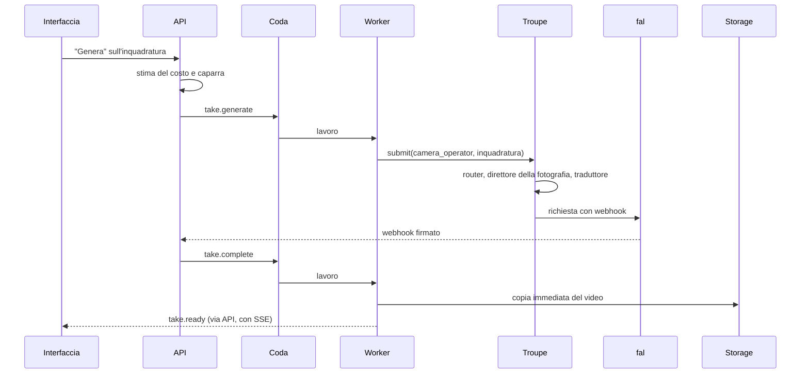

# Filmzy — Architettura

_Versione 1 · 19 ottobre 2026 · aggiornata il 20 ottobre 2026 (decisioni D17–D27)_

Questo documento descrive **com'è fatto** il sistema. Cosa fa il prodotto e perché sta in `contesto-progetto.md` (l'originale nel progetto Claude, una copia in `docs/`); le scelte e le alternative scartate in `decisioni.md`; l'ordine dei lavori in `piano-di-lavoro.md`.

## 1. Principi tecnici

1. **Il codice chiama ruoli, mai modelli.** Ogni lavoro AI è un ruolo della troupe. Quale modello lo svolge, con quali parametri e con quali istruzioni, è configurazione.
2. **La configurazione ha le stesse garanzie del codice:** validata, versionata, provata prima della pubblicazione, reversibile.
3. **Contratti prima.** Ogni dato che attraversa un confine ha uno schema Zod in `packages/contracts`.
4. **Ogni chiamata a un fornitore lascia uno scontrino**, anche se fallisce.
5. **I test non spendono:** nei test risponde il fornitore finto.
6. **I fornitori sono inaffidabili per definizione:** code, nuovi tentativi, idempotenza, copia immediata dei file.
7. **Le regole dei fornitori si rispettano:** un rifiuto per contenuto non si aggira provando un altro modello.

## 2. Stack e repository

| Area | Scelta | Perché |
|---|---|---|
| Linguaggio | TypeScript strict, ovunque | un solo linguaggio; contratti condivisi tra interfaccia e backend |
| Monorepo | pnpm workspaces + Turborepo | build e test incrementali |
| API | NestJS | moduli e dependency injection: la struttura è guidata dal framework |
| Worker | NestJS standalone + BullMQ su Redis | lavori lunghi fuori dall'API, nuovi tentativi, limiti di concorrenza |
| Interfaccia | React + Vite (SPA) | la logica sta nel backend; l'interfaccia mostra e invia |
| Database | PostgreSQL + Drizzle ORM | SQL leggibile, JSONB tipizzato con Zod |
| Storage | S3 compatibile: MinIO in locale, R2 in produzione | file privati, URL firmati a scadenza |
| Trasporto LLM | AI SDK (Vercel), solo dentro gli adapter | molti fornitori, output strutturati con Zod, `baseURL`, `headers` e `fetch` personalizzabili per gateway e proxy |
| Immagini e video | client ufficiale di fal, solo dentro l'adapter | un'API per molti modelli, coda con webhook firmati |
| Istruzioni | template LiquidJS | sintassi semplice e sicura anche quando le istruzioni si modificano dal pannello |
| Montaggio | ffmpeg | standard |
| Aggiornamenti live | Server-Sent Events | più semplici di WebSocket per notifiche dal server all'interfaccia |
| Deploy | Docker + Caddy | |
| Python | più avanti, come servizio separato | controllo dei volti, modelli locali: la troupe lo vede come una connessione in più |

```
filmzy/
├─ CLAUDE.md                regole per Claude Code
├─ docs/                    architettura, piano di lavoro, decisioni
├─ design/                  prompt dati a Figma e riferimenti grafici
├─ config/
│  ├─ ai/                   seme della troupe: connessioni, modelli, ruoli, istruzioni
│  │  └─ environments/      adattamenti per development, offline e test
│  ├─ presets/              stili, generi, toni, fotografia, tag dei personaggi, movimenti di macchina
│  ├─ features.yaml         funzioni attive e limiti
│  └─ bench/                piani delle prove sui modelli
├─ apps/
│  ├─ api/                  NestJS: HTTP, accesso, dominio, webhook, eventi
│  ├─ worker/               NestJS standalone: code BullMQ (generazioni, montaggio)
│  ├─ web/                  React: l'app e l'area /admin con il pannello della troupe
│  └─ bench/                riga di comando: valutazioni e prove dei modelli
├─ packages/
│  ├─ contracts/            schemi Zod: dominio, ruoli, configurazione, eventi
│  ├─ troupe/               livello AI: configurazione, router, adapter, traduttori, scontrini
│  ├─ db/                   schema Drizzle, migrazioni
│  └─ media/                ffmpeg, esportazione, etichetta AI
└─ docker-compose.yml       postgres, redis, minio, mailpit
```

## 3. Moduli e confini

| Modulo | Dove | Responsabilità |
|---|---|---|
| `auth` | api | registrazione, accesso, ruoli `user` e `admin` |
| `credits` | api, worker | registro dei crediti: accrediti, caparre, addebiti, rilasci |
| `projects` | api | il film: idea, genere, tono, stile, fotografia, lingua, durata, fase (§3.1) |
| `bible` | api | personaggi (con tag e dettagli), luoghi (con immagini), schede; assembla la Bibbia per i ruoli |
| `screenplay` | api, worker | sceneggiatura con versioni e fase (bozza o finale), richieste di modifica, riepilogo con le scelte |
| `scenes` | api | scene, inquadrature (ShotSpec), take |
| `generations` | worker | esegue i ruoli tramite la troupe, gestisce webhook e scontrini |
| `assets` | api, worker | file: caricamento con controllo delle immagini, ritocchi, copia dai fornitori, URL firmati |
| `audio` | api, worker | tracce e clip audio (musica, effetti, dialoghi), varianti, volumi (§5.5) |
| `continuity` | api, worker | stati di entrata e uscita, regole, segnalazioni gialle |
| `export` | worker | montaggio, mix delle tracce audio, titoli, etichetta e marcatura AI |
| `consents` | api | persone reali e consensi: tabelle presenti, funzione spenta nell'MVP |
| `troupe-admin` | api, web | pannello: bozza, prova, pubblicazione, storico, costi, connessioni e chiavi (§4.5) |

**Confini controllati dalla CI**, non affidati alla buona volontà:

- `apps/web` importa solo `packages/contracts`.
- Solo `packages/troupe/src/adapters/**` importa le librerie dei fornitori (`ai`, `@ai-sdk/*`, `@fal-ai/client`, …).
- `packages/troupe` non importa `packages/db`. Riceve la configurazione da una `ConfigSource` e scrive gli scontrini su un `ReceiptSink`: il worker li implementa con il database, il bench e i test con file o memoria. Così la troupe gira identica ovunque.
- Nel codice di `apps/` e `packages/` (test esclusi) non compaiono identificativi di modelli né URL di fornitori. Il controllo usa il catalogo stesso come elenco dei termini vietati.

### 3.1 Le fasi di un progetto

Il progetto avanza per fasi (D18). Si può sempre tornare a una fase precedente: le scelte successive restano e le differenze si ricalcolano al riepilogo.

| Fase | Cosa succede | Ruoli |
|---|---|---|
| `idea` | genere, tono, stile, fotografia, durata; il moderatore controlla il testo | `moderator` |
| `draft` | bozza breve della sceneggiatura; richieste di modifica a turno singolo («Parla con lo sceneggiatore»), moderate, che creano una nuova versione | `screenwriter` (`draft`, `revise`), `moderator` |
| `cast` | numero di personaggi (non oltre `limits.max_characters`), proposte dalla bozza con tag e dettagli facoltativi, schede a 3 angolazioni, volto bloccato | `casting`, `character_designer` |
| `locations` | 3–4 immagini del set per luogo, scelta e, se `retouch` è attiva, ritocco | `set_designer`, `retoucher` |
| `review` | il codice confronta la bozza con le scelte: una differenza è un personaggio o un luogo che la bozza cita e la Bibbia non ha, o viceversa (li collega il `proposalId`). Per ognuna: «Adatta la storia», «Cambia la mia scelta» o «Va bene così» (l'elemento resta come comparsa o luogo generico). Senza differenze il passo si salta | nessuno: la scelta pesa sulla stesura |
| `final` | stesura ufficiale, che usa solo cast e luoghi scelti più gli elementi accettati; poi modificabile come testo, con versioni | `screenwriter` (`final`) |
| `shots` | inquadrature, storyboard, immagini dell'inquadratura, take | `shot_planner`, `cinematographer`, `storyboard_artist`, `camera_operator`, `script_supervisor` |
| `sound` | tracce audio: musica per scena, effetti per inquadratura, suggerimenti dal copione («Suggerisci i suoni»), file audio propri; l'audio originale dei take è spento | `sound_planner`, `composer`, `sfx_artist` |
| `export` | montaggio, mix delle tracce ed esportazione | |

«Bozza» ha due significati: la bozza della sceneggiatura (utente) e la bozza della troupe (`TroupeDraft`, admin).

## 4. La troupe

### 4.1 L'idea

Su un set i ruoli sono fissi, e chi li ricopre si decide sul foglio di produzione. Qui il codice è il set e la configurazione è il foglio di produzione: il codice chiede a un ruolo e non sa quale modello risponderà, con quale temperatura o con quali istruzioni.

L'interfaccia pubblica di `packages/troupe`:

```ts
troupe.run(role, input, ctx)      // ruoli LLM: risposta tipizzata e scontrino
troupe.submit(role, input, ctx)   // ruoli immagine e video: lavoro lungo, restituisce l'id presso il fornitore
troupe.collect(receiptId, event)  // completa il lavoro quando arriva il webhook o il polling
troupe.estimate(role, input)      // costo previsto, per la caparra
```

### 4.2 I ruoli

| Id | Nome | Tipo | Riceve → restituisce | Quando |
|---|---|---|---|---|
| `moderator` | Moderatore | LLM | testo dell'utente → verdetto | MVP |
| `casting` | Direttore del casting | LLM | idea, bozza e cast attuale → proposte di personaggi, con tag e dettagli facoltativi | MVP |
| `screenwriter` | Sceneggiatore | LLM | tre modi: idea → bozza breve con personaggi e luoghi proposti; bozza + richiesta → bozza nuova; bozza + Bibbia → stesura ufficiale | MVP |
| `shot_planner` | Aiuto regista | LLM | scena e Bibbia → inquadrature (ShotSpec) | MVP |
| `cinematographer` | Direttore della fotografia | LLM | inquadratura + famiglia del modello → prompt visivo | MVP |
| `character_designer` | Character designer | immagine | personaggio e stile → scheda a 3 angolazioni | MVP |
| `set_designer` | Scenografo | immagine | luogo e stile → 3–4 immagini del set, senza persone | MVP |
| `retoucher` | Ritocco | immagine | immagine + maschera + operazione → immagine ritoccata | opzione dell'MVP (`retouch`) |
| `storyboard_artist` | Storyboard | immagine | modo `storyboard`: prompt visivo + riferimenti → 2–3 varianti; modo `end_frame`: primo fotogramma + movimento → ultimo fotogramma | MVP |
| `camera_operator` | Operatore di ripresa | video | prompt visivo + riferimenti → take | MVP |
| `script_supervisor` | Segretaria di edizione | LLM | scene e inquadrature → incoerenze con motivo | MVP |
| `composer` | Compositore | musica | atmosfera e durata di una scena → musica | MVP, spento finché non si sceglie il fornitore (T5.4) |
| `sfx_artist` | Rumorista | effetti sonori | descrizione e durata → 2–3 varianti | MVP, spento finché non si sceglie il fornitore (T5.4) |
| `sound_planner` | Sound designer | LLM | copione, scene e inquadrature → proposte di musica ed effetti | MVP |
| `voice_actor` | Doppiatore | voce | battuta + voce del personaggio → audio | Fase 2 |
| `lip_sync` | Sincronizzatore | video | take + audio → take sincronizzato | Fase 2 |
| `dialogue_adapter` | Adattatore dialoghista | LLM | dialoghi + durate → dialoghi tradotti | Fase 3 |

Il montaggio non è un ruolo: è deterministico (ffmpeg) e vive in `packages/media`.

**Cosa sta nel codice e cosa nella configurazione.** Nel codice ci sono l'elenco dei ruoli e i loro schemi di input e output (`packages/contracts/src/roles.ts`), perché è il codice a usare le risposte. Tutto il resto è configurazione.

**Lingue.** Interfaccia, istruzioni e testi per l'utente sono in italiano. I prompt per i modelli di immagini e video sono in inglese, perché di solito i modelli li seguono meglio: per le inquadrature li scrive il direttore della fotografia, per le schede personaggio il casting (campo `appearance.prompt`).

### 4.3 Tre livelli di configurazione

| Livello | Domanda | Campi principali |
|---|---|---|
| **Connessioni** | come si raggiunge un fornitore? | `adapter` (famiglia di protocollo), `base_url` (anche un gateway o un proxy LLM), `api_key` (`env:NOME` o `secret:NOME`), `http_proxy`, `timeout_s`, `max_concurrency`, `delivery` (webhook o polling), `media_retention`, `data_region`, `enabled` |
| **Catalogo dei modelli** | cosa sa fare, e quanto costa? | `kind`, `connection`, `provider_model`, `family`, `capabilities`, `params` accettati con i limiti, `pricing` con data di verifica, `quality` (voti delle prove), `status` (`active`, `testing`, `retired`) |
| **Ruoli** | chi fa cosa, e come? | `model` + `fallbacks` oppure `routing` (candidati + politica), `params`, `instructions` (`id@versione`), `prompt_from`, `output_strategy`, `retries`, `budget`, `enabled` |

**Un punto d'accesso, un modo (D20).** Ogni voce del catalogo è un punto d'accesso, cioè un id presso il fornitore, e dichiara in `capabilities.input_modes` le combinazioni di ingressi che accetta: `references`, `first_frame`, `first_frame+last_frame`, `references+first_frame`… Un modello che si usa in più modi ha più voci, con lo stesso `family` e il proprio prezzo. Per i modelli immagine, `image_edit` dice se modificano un'immagine data (serve al ritocco e all'ultimo fotogramma) e `mask_edit` se accettano una maschera vera. Il valore `unknown` conta come «no» per il router: solo il bench può provarlo.

I parametri dei ruoli usano un vocabolario nostro, normalizzato (`temperature`, `max_tokens`, `resolution: 720p`, `aspect_ratio: "16:9"`…). Adapter e traduttori li convertono nei nomi e nei valori di ciascun fornitore.

Con le stesse regole (validazione, pubblicazione, storico) si gestiscono anche:

- i **preset**: stili, generi, toni, fotografia, tag dei personaggi e movimenti di macchina. L'interfaccia li mostra, i ruoli li usano. Un nuovo stile è un dato, non codice;
- le **funzioni**: `real_people`, `dialogue`, `dubbing`, `music`, `preview_gate`, `keyframes`, `image_upload`, `retouch`;
- i **limiti**: `max_characters` (personaggi principali per film, 2 nell'MVP), applicato dal backend.

Esempi completi nei file di seme: `config/ai/*.yaml`, `config/presets/*.yaml`, `config/features.yaml`.

### 4.4 Le istruzioni

- `screenwriter@1` corrisponde al file `config/ai/instructions/screenwriter/v1.md`. L'intestazione contiene `id`, `version`, `description`, `variables` e `changelog`; il corpo, le sezioni `## system` e `## user`. I template per le immagini hanno `kind: image_prompt`, quelli per i suoni `kind: audio_prompt`, e una sola sezione `## prompt`.
- Template LiquidJS. Le variabili sono i campi dell'input del ruolo (camelCase). Le variabili facoltative arrivano sempre, con valore `null` quando mancano, mai assenti: così la modalità rigorosa segnala solo i veri errori e `` funziona anche senza scena.
- **Varianti per famiglia:** `v1.seedance.md` si usa quando il modello di destinazione è della famiglia `seedance`. Può aggiungere regole alla base (`mode: append`) o sostituirla (`mode: replace`). Servono soprattutto al direttore della fotografia, perché ogni famiglia "capisce" i prompt a modo suo.
- Una versione pubblicata non si modifica più: si crea la successiva. Lo scontrino registra versione e variante usate.
- Nel pannello: editor, elenco delle variabili disponibili, anteprima con un input di esempio.

### 4.5 Dove vive la configurazione

**In esercizio vive nel database e si modifica dal pannello admin** (decisione D2). Funziona come un deploy:

1. **Bozza:** l'unica copia modificabile, validata a ogni salvataggio.
2. **Prova:** dalla bozza si esegue un ruolo su un input di esempio, con risultato e costo reali, prima di pubblicare.
3. **Pubblicazione:** crea una *release* immutabile, con configurazione completa, versioni delle istruzioni bloccate, hash, nota e autore. API e worker la caricano, e un avviso via Redis li fa ricaricare senza riavvio.
4. **Ripristino:** si ripubblica una release precedente come nuova release, così lo storico resta lineare.

**I file YAML restano utili.** `pnpm troupe import config/ai` crea una bozza dai file (primo avvio, nuovo ambiente); `pnpm troupe export config/ai` scrive la release attiva su file, da salvare in git come copia e come storia. I test e il bench caricano i file direttamente, senza database. La troupe riceve la configurazione da una `ConfigSource` — file (test, bench, M1) o database (esercizio, da M2) — e la valida sempre con lo stesso validatore.

**Precedenze al momento dell'uso, dalla più debole alla più forte:**

1. release attiva (o file di seme);
2. adattamento d'ambiente (`config/ai/environments/<env>.yaml`, nel repository): per esempio polling al posto dei webhook in locale, fornitore finto nei test. La fusione è profonda, le liste si sostituiscono, la chiave `"*"` vale per tutte le voci di una sezione;
3. in futuro, esperimenti A/B;
4. override della singola chiamata, solo per bench e "Prova".

La configurazione risolta di ogni ruolo produce un hash, che finisce nello scontrino.

**Segreti (D25):** una chiave si cita nella configurazione con `env:NOME` (variabile d'ambiente: seme, test, sviluppo) o con `secret:NOME` (dal database). L'amministratore le inserisce da «Impostazioni > Connessioni»: collega un fornitore, incolla la chiave, «Prova la connessione» (una chiamata gratuita), sceglie i modelli da aggiungere, poi li assegna ai ruoli in «Chi fa cosa». Nel database le chiavi sono cifrate (AES-256-GCM) con una chiave principale (`SECRETS_MASTER_KEY`) che sta solo in una variabile d'ambiente. Sono in sola scrittura: l'API non le restituisce mai, l'interfaccia mostra «Chiave collegata ••••1a2b», non finiscono nei log né negli export (`pnpm troupe export` scrive solo i riferimenti) e ogni azione va nel registro.

### 4.6 Validazione

La stessa funzione valida file, bozze e release (`pnpm troupe check` e pannello):

1. **Struttura** di ogni sezione (schemi in `packages/contracts/src/config`).
2. **Riferimenti:** ogni ruolo punta a modelli esistenti, ogni modello a una connessione attiva, i tipi combaciano (un ruolo LLM non usa un modello video); `prompt_from` punta a un ruolo LLM che restituisce un prompt visivo.
3. **Parametri:** i `params` del ruolo sono accettati da *ogni* modello che può servirlo (principale, riserve, candidati) e rispettano i limiti. Esempio: un modello che non accetta `temperature` dà un errore che nomina ruolo, modello e parametro.
4. **Istruzioni:** la versione esiste, l'intestazione combacia, e un rendering di prova in modalità rigorosa, con un input di esempio generato dallo schema, non trova variabili inesistenti.
5. **Segreti:** esistono le variabili d'ambiente (`env:`) e i segreti nel database (`secret:`) delle connessioni attive (tranne in test).
6. **Prezzi:** un prezzo mancante è un avviso nei file di seme e un errore alla pubblicazione; avviso se la verifica ha più di 30 giorni.
7. **Stato:** nessun ruolo usa modelli `retired`; i modelli `testing` danno un avviso. Un identificativo segnaposto (`<…>`) è ammesso solo con `status: testing` e blocca la chiamata reale.
8. **Funzioni:** se `real_people` è attiva, ogni ruolo video ha almeno un candidato che accetta volti reali verificati.
9. **Capacità:** un ruolo che richiede una capacità ha almeno un candidato che la dichiara vera. Oggi: `retoucher` e il modo `end_frame` di `storyboard_artist` chiedono `image_edit`; se `keyframes` è attiva, il catalogo ha almeno una voce video con `first_frame+last_frame`.

Una configurazione non valida non si pubblica. Se una release caricata risulta non valida (per esempio perché manca una chiave), il servizio tiene la precedente e manda un avviso.

### 4.7 Adapter e traduttori

**Adapter: come si parla a una famiglia di protocollo.** Uno per famiglia, non uno per modello.

```ts
interface LlmAdapter {
  generate(req: LlmRequest): Promise<LlmResponse>; // testo, o oggetto validato con lo schema del ruolo
}

interface MediaAdapter {
  submit(req: MediaRequest): Promise<{ providerRequestId: string }>;
  poll(providerRequestId: string): Promise<MediaStatus>;
  verifyWebhook(rawBody: Buffer, headers: Headers): Promise<MediaStatus>;
  cancel?(providerRequestId: string): Promise<void>;
}
```

- `anthropic`, `openai_compatible` e `google` usano AI SDK. `baseURL`, `headers` e `fetch` personalizzati coprono gateway e proxy di rete. Con `openai_compatible` entrano OpenRouter, i modelli locali (Ollama, vLLM) e qualunque gateway compatibile.
- `fal` usa la coda di fal con webhook. Le consegne sono firmate (Ed25519, chiavi pubbliche in JWKS, firma sugli header `X-Fal-Webhook-*` e sull'hash del corpo grezzo, tolleranza di 300 secondi), e la firma si verifica sempre. Fal ripete la consegna fino a 31 volte, quindi la gestione è idempotente. Non consegna a indirizzi privati o locali: in sviluppo si usa il polling.
- `fake` restituisce risposte registrate o generate dallo schema: zero rete, zero costi.
- `elevenlabs` per la musica (la ricerca del 13/10 la indica con API e diritti commerciali), con la stessa interfaccia `MediaAdapter` dei video: invio, attesa, risultato. Il fornitore degli effetti sonori si sceglie in T5.4.
- Più avanti: `http_service` per i nostri servizi (per esempio il controllo dei volti in Python), `elevenlabs` anche per le voci, `sync` per il labiale.

**Traduttori: come si scrive una richiesta per una famiglia di modelli.** Servono ai ruoli immagine e video.

```ts
interface Translator {
  family: string;                                           // 'kling' | 'seedance' | 'gemini_omni' | 'image_generic'
  check(input: TranslateInput, model: ModelEntry): Issue[]; // durata, riferimenti, personaggi, volti, minori
  build(input: TranslateInput, model: ModelEntry): MediaRequest;
}
```

1. Il **direttore della fotografia** (LLM, istruzioni con variante per famiglia) scrive il prompt e indica i personaggi con segnaposto neutri: `[[char:anna]]`.
2. Il **traduttore** sostituisce i segnaposto con la sintassi della famiglia (per esempio `@Image1`, `<<<element_1>>>`, `<IMAGE_REF_0>`), ordina le immagini di riferimento, porta durata, formato e risoluzione ai valori ammessi e costruisce il payload.
3. Le immagini usano il traduttore generico `image_generic`, guidato dai campi del catalogo (`request_fields`).
4. Il traduttore conosce il modo d'ingresso della voce scelta (`input_modes`) e mette riferimenti, primo e ultimo fotogramma nei campi giusti. Per il ritocco `image_generic` passa l'immagine e, se `mask_edit` è vero, la maschera; altrimenti evidenzia la zona sull'immagine e lo dice nel prompt. Nel prompt del direttore della fotografia `target.inputs` elenca gli ingressi scelti e `target.frame` dice se è una clip (`clip`) o un fotogramma (`start`, `end`).

### 4.8 Router

Per i ruoli con `routing` (storyboard e operatore):

1. **Filtra** i candidati per stato, tipo e capacità richieste: durata, numero di personaggi e di riferimenti, audio, volti reali, minori, prezzo entro il budget, modo d'ingresso scelto dall'utente (`input_modes`) e `image_edit` per il ritocco e l'ultimo fotogramma.
2. **Ordina** secondo la politica (`cheap`, `balanced`, `quality`), pesando qualità (voti delle prove per tipo di inquadratura), costo e tempo.
3. **Restituisce** una lista: il primo è il principale, gli altri sono riserve **solo per errori tecnici**.

A parità di richiesta e di release il risultato è sempre lo stesso. Regola pratica: `routing` quando le richieste cambiano forma (una o due persone in scena), `model` + `fallbacks` quando sono tutte uguali.

**Le scelte dell'utente sono requisiti (D20).** Se l'utente ha impostato un primo o un ultimo fotogramma, il filtro tiene solo le voci che accettano quella combinazione, e le riserve devono rispettarla. Se nessuna la accetta, errore `no_eligible_model` con un messaggio semplice (per esempio «questa combinazione non è disponibile: prova a usare l'immagine come ispirazione»), senza addebiti. Non si declassa mai in silenzio.

### 4.9 Output strutturati

- `output_strategy: auto` usa l'output strutturato nativo se il modello lo dichiara (`capabilities: [structured_output]`), altrimenti JSON con validazione.
- Se la risposta non è valida, si riprova passando al modello l'errore di validazione, fino a `retries.invalid_output` volte; poi errore `invalid_output`.

### 4.10 Errori e riserve

| Codice | Significato | Riprova | Passa alla riserva |
|---|---|---|---|
| `provider_unavailable`, `timeout`, `rate_limited` | problema tecnico | sì, con attesa crescente | sì, finiti i tentativi |
| `invalid_output` | risposta fuori schema | sì, con riparazione | sì |
| `content_rejected` | il fornitore rifiuta il contenuto | no | **no**: ci si ferma, messaggio semplice, caparra rilasciata |
| `budget_exceeded` | stima oltre il budget del ruolo | no | no |
| `no_eligible_model` | nessun candidato soddisfa i requisiti | no | no |
| `config_invalid`, `role_disabled` | configurazione | no | no |

### 4.11 Scontrini

Ogni chiamata a un fornitore scrive uno scontrino: prodotto, prove dal pannello, valutazioni, bench, tentativi falliti. Contiene:

- **chi e perché:** ruolo, scopo (`product`, `draft_test`, `eval`, `bench`), utente, progetto, inquadratura;
- **con cosa:** release, hash della configurazione del ruolo, modello, connessione, id del modello presso il fornitore, versione e variante delle istruzioni, parametri;
- **cosa è successo:** hash dell'input, richiesta (conservata 90 giorni), id della richiesta presso il fornitore, esito, codice d'errore, tentativi, riserva usata;
- **quanto:** uso (token, secondi, immagini), costo stimato e reale, tempi.

Serve per i costi, il debug e il confronto tra modelli, per ricostruire come è nato un take e per rigirare un film con un modello migliore.

### 4.12 Aggiungere un modello: tre casi

| Caso | Passi | Codice |
|---|---|---|
| **A. Un LLM nuovo**, di un fornitore già collegato o compatibile con OpenAI | voce nel catalogo dal pannello → validazione → "Prova" sugli esempi fissi del ruolo → assegnazione al ruolo → pubblicazione | nessuno |
| **B. Un modello immagine o video di una famiglia nota** (per esempio una nuova versione di Kling) | voce nel catalogo con capacità e prezzo → se serve, variante delle istruzioni del direttore della fotografia → bench → voti nel catalogo → aggiunta ai candidati → pubblicazione | di solito nessuno |
| **C. Una famiglia o un protocollo nuovi** | traduttore (`packages/troupe/src/translators/<famiglia>.ts`) o adapter (`.../adapters/<nome>.ts`) con test su fixture registrate, registrato nell'indice dei plugin → poi come B | isolato: nessuna modifica alle app |

### 4.13 Prove

- **Fornitore finto**, di default nei test, con fixture registrate.
- **Valutazioni dei ruoli LLM** (`pnpm eval <ruolo> --model <voce>`): esempi fissi in `config/evals/<ruolo>/`, controllo dello schema, regole semplici (per esempio la durata totale, solo i personaggi della Bibbia), giudizio di un LLM su una griglia; report di qualità, costo e tempo. Si lanciano a mano, perché costano.
- **Bench dei modelli immagine e video** (`pnpm bench run config/bench/week1.yaml`): matrice personaggi × inquadrature × modelli × take, report HTML con voto alla cieca, quota di take usabili, costo per secondo usabile. I voti entrano nel catalogo (`quality`) e il router li usa.

## 5. Contratti principali

Sono in `packages/contracts` come schemi Zod; qui ne è descritta la forma.

### 5.1 Bibbia

La Bibbia resta "un unico oggetto che ogni ruolo legge", ma nel database è fatta di tabelle (§6), perché personaggi e luoghi devono essere riusabili tra film e citabili dalle inquadrature. Il modulo `bible` la assembla:

```ts
StoryBible {
  project: { id, title, idea, genre, tone, language, durationS }
  style: StylePreset
  cinematography: CinematographyPreset
  characters: Character[]   // id, name, tag, role, description, profile?, appearance, sheet: AssetRef[], voiceId?, proposalId?
  locations: Location[]     // id, name, description, prompt, references: AssetRef[], proposalId?
  limits: { maxCharacters }
}
```

Il `profile` del personaggio (`personality?`, `behavior?`, `goal?`) è facoltativo (D22) e `tag` è l'id di un preset `character_tags`. `proposalId` collega i personaggi e i luoghi scelti alle proposte della bozza (D18): è ciò che usa il riepilogo per trovare le differenze. Il `prompt` del luogo è la sua descrizione in inglese, scritta dallo sceneggiatore.

### 5.2 ShotSpec 0.2

È la scheda inquadratura del contesto, nella versione 0.2 (aggiornata il 20/10/2026 con le immagini dell'inquadratura, D20; non è mai stata usata nel codice):

```ts
ShotSpec {
  schema: 'shot-spec/0.2'
  id, sceneId, order
  intent: { action, emotion, framing, cameraMovement, lighting, durationS }   // cameraMovement: id di camera_movements
  characters: { characterId, costume, references: AssetRef[] }[]
  location: { locationId, references: AssetRef[] }
  images: ShotImage[]                                       // scelte dell'utente (D20); vuoto = decide l'aiuto regista
  dialogue: { characterId, text, voiceId?, language }[]     // vuoto nell'MVP
  cinematography: 'inherit' | CinematographyOverride
  continuity: { entry: ContinuityState, exit: ContinuityState }
}

ContinuityState { locationId, timeOfDay, present: CharacterId[], costumes: Record<CharacterId, string>, props: string[] }

ShotImage { use: 'reference' | 'first_frame' | 'last_frame', from: 'upload' | 'generate' | 'take_frame', assetId?, takeId?, atS? }
```

`upload` è un'immagine caricata (luogo o oggetto, mai persone: D19) e porta `assetId`. `generate` chiede di generarla: il risultato è un take `keyframe` e vale quello scelto. `take_frame` è il fotogramma al secondo `atS` del take `takeId`, estratto con ffmpeg. Il ruolo `first_frame` o `last_frame` è un requisito per il router (§4.8). Il `shot_planner` non compila `images`: le imposta l'utente.

I risultati non stanno nella scheda. Ogni tentativo è un **Take**: `shotId`, `kind` (`storyboard`, `keyframe`, `preview`, `final`), `generationId`, `assetId`, `chosen`, `checks`.

### 5.3 Input e output dei ruoli

| Ruolo | Input | Output |
|---|---|---|
| `moderator` | `text`, `context` (`idea`, `character`, `scene`), `language` | `allowed`, `category?`, `reason`, `suggestion?` |
| `casting` | `mode` (`initial`, `scene`), `idea`, `genre`, `tone`, `style`, `screenplay?` (la bozza), `cast`, `scene?`, `count`, `tags`, `language` | `suggestions[]`: `action` (`new`, `reuse`), `characterId?`, `proposalId?`, `name`, `tag`, `role`, `relationToProtagonist`, `description`, `profile?` (`personality?`, `behavior?`, `goal?`), `appearance` (`apparentAge`, `build`, `hair`, `face`, `clothing`, `distinctive`, `prompt` in inglese), `why` |
| `screenwriter` | `mode` (`draft`, `revise`, `final`), `idea`, `genre`, `tone`, `style`, `durationS`, `language`, `maxCharacters`, `dialogueEnabled`, `characters`, `locations`, `draft?`, `request?`, `accepted` | `title`, `logline`, `characters[]` (`id`, `name`, `role`) e `locations[]` (`id`, `name`, `description`, `prompt` in inglese): proposte, vuote nel modo `final`; `scenes[]` (`number`, `heading`, `locationId?`, `timeOfDay`, `characterIds`, `summary`, `beats` vuoti nella bozza, `durationS`), `notes?` |
| `shot_planner` | `scene`, `bible`, `shotDurationS` (`min`, `max`), `previousExit?`, `cameraMovements`, `language` | `shots[]` (ShotSpec senza id, senza `images` e senza i `references`, che aggiunge il codice), `notes?` |
| `cinematographer` | `shot`, `characters` (con `costume`), `location`, `style`, `cinematography`, `movement`, `target` (`family`, `kind`, `maxPromptChars`, `frame`: `clip`, `start` o `end`; `inputs`: gli ingressi scelti) | `prompt`, `negativePrompt?`, `notes?` |
| `script_supervisor` | `screenplay`, `scenes`, `shots`, `language` | `issues[]` (`sceneId?`, `shotId?`, `code`, `severity`, `reason`) |
| `character_designer` | `character`, `style`, `angle` (`front`, `profile`, `three_quarter`) | immagine |
| `set_designer` | `location`, `style`, `variants` | immagini |
| `retoucher` | `image`, `mask`, `operation` (`remove`, `replace`, `recolor`), `instruction?`, `style` | immagine |
| `storyboard_artist` | `mode` (`storyboard`, `end_frame`), prompt visivo, riferimenti, `variants`, `baseImage?` (per `end_frame`) | immagini |
| `camera_operator` | prompt visivo, riferimenti, `durationS` | video |
| `composer` | `cue` (`description`, `mood`, `durationS`), `genre`, `tone`, `style` | musica |
| `sfx_artist` | `cue` (`description`, `durationS`), `variants` | effetti sonori |
| `sound_planner` | `screenplay`, `scenes`, `shots`, `genre`, `tone`, `style`, `language` | `cues[]`: `kind` (`music`, `sfx`), `sceneId`, `shotId?`, `atS?`, `durationS`, `mood?` (in inglese), `description` |

`accepted` è l'elenco degli elementi della bozza che l'utente ha deciso di tenere così come sono (`kind`, `name`), vuoto fuori dal modo `final`. Nel ritocco l'`instruction` dell'utente va al modello così com'è, in italiano (D21).

### 5.4 Eventi

`generation.queued`, `generation.running`, `take.ready`, `take.failed`, `take.rejected`, `image.ready`, `image.failed` (immagini del set, ritocchi, fotogrammi chiave), `audio.ready`, `audio.failed`, `continuity.flagged`, `export.ready`. Partono dal worker via Redis e arrivano all'interfaccia via SSE.

### 5.5 Tracce audio

```ts
AudioTrack { id, projectId, kind: 'native' | 'dialogue' | 'music' | 'sfx', muted, volume }
AudioClip  { id, trackId, sceneId, shotId?, startS, durationS, volume, fadeInS, fadeOutS, description, chosenVariantId?, source: 'generated' | 'native' | 'uploaded' }
```

- La traccia `native` porta l'audio originale dei take: spenta di default, si accende per un take. La traccia `dialogue` accetta registrazioni caricate dall'utente (una voce fuori campo, senza labiale); la generazione delle voci è Fase 2.
- Una clip di musica sta su una scena (`shotId` vuoto); una clip di effetto sta su un'inquadratura e `startS` conta dall'inizio di quell'inquadratura. Niente timeline libera nell'MVP.
- Ogni clip generata ha delle varianti, come i take: `chosenVariantId` è quella in uso. Cambiare una variante non tocca i video. Una clip caricata ha un solo file (D27).
- Il mix si rifà a ogni esportazione (§9). Il testo di `description` passa dal moderatore.

## 6. Dati (PostgreSQL)

| Gruppo | Tabelle | Note |
|---|---|---|
| Utenti e crediti | `users`, `credit_ledger` | registro con `grant`, `purchase`, `hold` (caparra), `capture` (addebito), `void` (rilascio), `refund`; il saldo è la somma |
| Film | `projects`, `characters`, `character_assets`, `locations`, `location_assets`, `screenplays`, `scenes`, `shots`, `takes`, `continuity_flags` | `characters.project_id` nullo = cast riutilizzabile; `characters.profile` (JSONB), `tag`, `proposal_id`; `locations.prompt`, `proposal_id`; `screenplays` ha versioni e `stage` (`draft`, `final`); `shots.spec` è JSONB (ShotSpec) |
| File | `assets` | tipo, chiave nello storage, mime, dimensioni, durata, origine, checksum, stato dell'etichetta AI, asset di origine e dati del ritocco (operazione, maschera: il ritocco crea un asset nuovo e l'originale resta), esito del controllo delle immagini caricate |
| Troupe | `troupe_drafts`, `troupe_releases`, `instruction_versions`, `generations` | `generations` sono gli scontrini |
| Audio | `audio_tracks`, `audio_clips`, `audio_variants` | le varianti hanno uno scontrino come i take |
| Segreti | `secrets` | nome, testo cifrato, versione della chiave principale, autore, date di creazione e di sostituzione |
| Esportazioni | `exports` | |
| Consensi (spenti) | `real_people`, `consents`, `provider_assets` | ambito (volto, voce), metodo, prove, revoca; asset registrati presso i fornitori, da cancellare alla revoca |
| Moderazione | `reports` | segnalazioni e rimozioni |

## 7. Pipeline di una generazione



1. L'utente preme "Genera". L'API controlla il saldo, chiede alla troupe la stima (`troupe.estimate`), crea la **caparra** e lo scontrino (`queued`), mette in coda `take.generate` con una chiave di idempotenza.
2. Il worker assembla Bibbia e ShotSpec. La troupe sceglie il modello (router), il direttore della fotografia scrive il prompt, il traduttore costruisce la richiesta e l'adapter la invia con il webhook. Scontrino `running`.
3. Fal chiama il webhook. L'API verifica la firma, mette in coda `take.complete` e risponde subito 200.
4. Il worker scarica subito il video nello storage privato, crea asset e take, chiude lo scontrino con costo reale e tempi, **addebita** la caparra e pubblica `take.ready`.
5. L'interfaccia riceve l'evento via SSE e mostra il take nella card.
6. Se qualcosa va storto: errori tecnici → nuovi tentativi e riserve; `content_rejected` → take rifiutato, caparra rilasciata, messaggio semplice; nessuna risposta entro il tempo massimo → `failed`, caparra rilasciata.

## 8. Continuità e giallo

- Ogni inquadratura ha uno stato di **entrata** e uno di **uscita**: luogo, ora, chi c'è, costumi, oggetti.
- **Regole deterministiche**, immediate e gratuite:
  - **R1:** nella stessa scena l'entrata dell'inquadratura N+1 combacia con l'uscita della N, salvo un cambiamento dichiarato;
  - **R2:** se cambia l'uscita di un'inquadratura, diventano gialle quelle che ne dipendono;
  - **R3:** se la scheda di un personaggio cambia dopo un take (anche per un ritocco che tocca volto o abiti), diventano gialli i take con quel personaggio;
  - **R4:** se cambia la fotografia del film, i take girati con la precedente ricevono un avviso leggero;
  - **R5:** se cambia il primo o l'ultimo fotogramma di un'inquadratura, o la scelta tra generarlo e caricarlo, i take girati prima diventano gialli;
  - **R6:** se l'immagine scelta di un luogo cambia o viene ritoccata, diventano gialle le inquadrature che lo usano;
  - **R7:** se un personaggio viene scartato o sostituito dopo la stesura ufficiale, diventano gialle le scene che lo nominano;
  - **R8:** se un take cambia durata o viene sostituito, gli effetti agganciati a quell'inquadratura ricevono un avviso leggero («l'effetto potrebbe non coincidere più»).
- **Segretaria di edizione** (LLM): incoerenze di trama tra le scene ("Marco parla di una lettera che non ha ancora ricevuto").
- Ogni segnalazione ha un codice, un motivo in italiano e un'origine (`rule`, `llm`, più avanti `vision`). L'utente sceglie **Rigenera** o **Ignora**: niente rigenerazioni automatiche.

## 9. Montaggio ed esportazione

- Normalizzazione dei take scelti (risoluzione, fotogrammi al secondo, codec), con l'audio originale tolto salvo che l'utente lo accenda per un take; concatenazione; titoli di testa e di coda.
- Mix delle tracce audio (D24): musica per scena con dissolvenza incrociata, effetti agganciati alle inquadrature, dialoghi quando ci saranno, con livellamento del volume. Le tracce si ricalcolano a ogni esportazione: cambiare una musica o un effetto non tocca i video.
- Nei titoli compare la dicitura "Contiene contenuti generati con intelligenza artificiale".
- Marcatura leggibile dalle macchine (C2PA, strumento da scegliere in M5). Filigrane e metadati dei fornitori non si rimuovono.
- Il file finale va nello storage privato e si scarica con un URL firmato a scadenza.

## 10. Sicurezza, privacy e consensi

- Ogni lettura del dominio è filtrata per proprietario. Il pannello della troupe è riservato agli `admin` e registra ogni azione.
- Storage privato con URL firmati; copia immediata dai CDN dei fornitori e retention breve dove il fornitore lo permette.
- **Moderatore** sui testi dell'utente prima di ogni spesa: persone reali o famose, minori, contenuti vietati. La politica sta nelle istruzioni del moderatore, quindi è configurabile e versionata.
- **Immagini caricate (D19):** sono ammessi luoghi e oggetti. Prima di salvarle, un modello con visione (capacità `vision`) controlla che non ci siano persone, minori, marchi o personaggi noti; l'esito resta nell'asset. Un'immagine con persone si rifiuta con un messaggio semplice. Con i fornitori vale la regola 11: copia subito e retention breve. La funzione `image_upload` resta spenta finché questo controllo non c'è.
- **Ritocchi (D21):** sono lo strumento classico per alterare persone reali, quindi operano solo su immagini generate da noi o già approvate dal controllo. Il testo libero dell'utente passa dal moderatore prima di ogni spesa.
- **Suoni (D24, D27):** il testo che descrive un suono passa dal moderatore. L'utente può caricare file audio propri, come in un programma di montaggio, ma: al caricamento dichiara di avere i diritti (e il consenso, se c'è la voce di un'altra persona) e la dichiarazione resta nel registro; i file restano privati nel progetto, senza link pubblici; **non vanno mai a un fornitore AI** (servono solo al mix con ffmpeg); un file segnalato si rimuove (tabella `reports`). Il servizio gestito dall'autore ospita i file: risponde di ciò che conosce o che gli viene segnalato, anche se il codice è aperto. Funzione `audio_upload`, spegnibile dall'amministratore.
- **Chiavi (D25):** cifrate nel database e in sola scrittura, mai nei log né negli export. La chiave principale sta solo in una variabile d'ambiente. Solo gli `admin` le gestiscono e ogni azione va nel registro.
- **Limiti di spesa:** per utente al giorno e globali al giorno, più quelli impostati sui cruscotti dei fornitori.
- **GDPR:** esportazione e cancellazione dei dati dell'utente. I corpi delle richieste negli scontrini si conservano 90 giorni, i metadati restano.
- **Cast personale:** tabelle pronte, funzione `real_people` spenta. Quando si accende: verifica dal vivo fatta dalla persona stessa; router limitato ai modelli che accettano volti verificati; la revoca blocca le nuove generazioni e cancella gli asset presso i fornitori.

## 11. Osservabilità e costi

- Log JSON (pino) con `requestId`, `generationId` e `jobId`.
- Cruscotto delle code (bull-board) nell'area admin.
- Pannello dei costi costruito sugli scontrini: per giorno, ruolo, modello e utente, con avviso quando la spesa del giorno supera una soglia.
- Tracciamento degli errori (Sentry o GlitchTip in self-hosting).

## 12. Test

| Livello | Cosa | Quando |
|---|---|---|
| Unità | validatore della configurazione, precedenze, router, registro dei crediti, regole di continuità | sempre, in CI |
| Contratto | adapter e traduttori contro fixture registrate | sempre, in CI |
| Configurazione | `pnpm troupe check` sui file di seme | sempre, in CI |
| Integrazione | pipeline completa con fornitore finto | sempre, in CI |
| Valutazioni | ruoli LLM su esempi fissi | a mano, prima di cambiare modello o istruzioni |
| Bench | modelli immagine e video | a mano, per ogni candidato nuovo |
| End-to-end | flussi dell'interfaccia con Playwright e fornitore finto | da M4 |

## 13. Decisioni aperte

- Libreria di autenticazione (inizio di M2).
- Strumento per la marcatura C2PA (M5).
- Fornitori della musica e degli effetti sonori (T5.4): per la musica c'è già una candidata nella ricerca del 13/10, per gli effetti serve una ricerca nuova.
- Modello di guadagno (crediti a pagamento, oppure servizio aperto con donazioni) e licenza del codice, da decidere prima di rendere pubblico il repository.
- Esperimenti A/B dal pannello (dopo l'MVP).
- Dialoghi: audio nativo del modello o voce nostra + labiale (Fase 2).
- Id e capacità dei punti d'accesso con primo e ultimo fotogramma (`input_modes`): da verificare sulla documentazione dei fornitori e con il bench (D20).
- Traduzione in inglese del testo di ritocco scritto dall'utente: per ora va al modello così com'è (D21, D15).
- Formati (spot, trailer, videoclip) che decidono quali campi del personaggio sono obbligatori, e elenco definitivo dei tag (D22).
- Modifica vera del video (`video_edit`): da provare dopo l'MVP su 3–4 clip (D21).

## Fonti

Verificate il 19 ottobre 2026; prezzi e capacità dei modelli immagine e video vengono dalla ricerca del 13 ottobre (`ricerca-ottobre-2026.md`).

- [fal: webhook, firma e nuovi tentativi](https://fal.ai/docs/model-apis/webhooks)
- [fal: conservazione dei file e URL pubblici](https://fal.ai/docs/documentation/model-apis/faq.md)
- [AI SDK: provider compatibili con OpenAI](https://ai-sdk.dev/providers/openai-compatible-providers)
- [AI SDK: provider Anthropic e output strutturati](https://ai-sdk.dev/providers/ai-sdk-providers/anthropic)
- [Anthropic: prezzi delle API](https://platform.claude.com/docs/en/about-claude/pricing)
